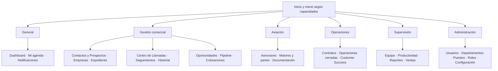
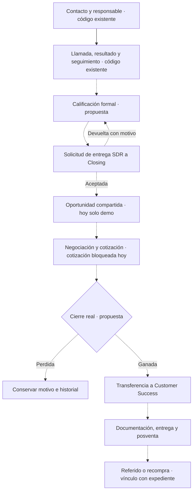

# CRM Aviación privada — Auditoría y propuesta de arquitectura

**Revisión del 18 de noviembre de 2026.** Rama `main`, base `e9640a4` y cambios locales preexistentes de Staging. Base de referencia: [manual de funcionamiento](MANUAL_ESTRUCTURA_Y_FUNCIONAMIENTO_CRM_AVIACION.md).

## 1. Decisión para la primera etapa

El CRM ya tiene una ficha de prospecto, llamadas programadas, resultados, seguimientos e historial de llamadas. La primera prioridad es recuperar la operación de esas pantallas en Staging y asegurar que una falla de llamadas no impida abrir el listado de contactos. La segunda es completar el expediente y construir el traspaso comercial sobre los mismos registros. Oportunidades, cotizaciones y posventa necesitan una integración persistente antes de servir como fuente de indicadores de ventas.

La comprobación de Staging se repitió con GET anónimo y cero filas solicitadas. Las tres vistas de llamadas volvieron a responder **404 / PGRST205** y `llamadas`, `prospectos` y `perfiles` respondieron **401 / 42501**. Pasaron las **26 pruebas locales seleccionadas** de rutas, contactos, métricas, oportunidades, cotizaciones y PDF. Las pruebas locales con dobles verifican comportamiento de la aplicación. La persistencia y los permisos con cuentas reales siguen **NO VERIFICADOS**. La revisión agregó documentos y un diagnóstico SQL de solo lectura para ejecución manual.

## 2. Fase A — Vue 3

### Inventario y estado

| Función | Estado | Evidencia y límite |
| --- | --- | --- |
| Rutas, guardas y menú | EXISTENTE Y VERIFICADO | Se inspeccionaron rutas y pasó la prueba local de guardas. Menú y acceso de pantalla usan rol genérico. |
| Login, invitación y salida | PARCIALMENTE IMPLEMENTADO | Flujo visible en código con verificación de perfil activo y Auth. Inicio autenticado, invitación y persistencia de sesión de Staging **NO VERIFICADOS**. |
| Contactos y prospectos | EXISTENTE CON PROBLEMAS | Alta y edición cubiertas con dobles. El listado real usa `prospectos` y el shell puede ocultarlo ante un error de llamadas. Alta y edición están bloqueadas en Staging. `/prospectos` redirige a `/contactos`. |
| Dashboard, Llamadas y Reportes | EXISTENTE CON PROBLEMAS | Dependen de las tres vistas REST con 404. El reporte actual calcula actividad telefónica sobre una muestra de hasta 200 llamadas. |
| Centro de Llamadas y Seguimientos | PARCIALMENTE IMPLEMENTADO | Formulario, filtros, tabla, tarjeta móvil, panel de detalle y resultados existentes. El centro integrado, métricas globales exactas, registro manual completo y paginación navegable faltan. |
| Seguimientos y Mi agenda | EXISTENTE CON PROBLEMAS | Seguimientos agrupa llamadas por fechas y estado y usa una RPC con llamada padre. La vista de atrasadas devuelve 404 y el bloqueo local impide crear seguimientos. Agenda diaria, semanal, mensual y actividades distintas de llamadas **NO IMPLEMENTADAS**. |
| Historial y expediente | PARCIALMENTE IMPLEMENTADO | Contactos ya tiene Resumen, Llamadas e Historial con información de llamadas cargadas. Existen además historial de una llamada y auditoría de usuarios. Faltan historial comercial completo y pestañas de Seguimientos, Oportunidades, Cotizaciones y Documentos. |
| Oportunidades y Pipeline | EXISTENTE Y VERIFICADO en demo | Las pruebas pasan para tablero, edición, etapas e historial local. Los datos viven en `sessionStorage` o memoria. El adaptador real está desactivado. Persistencia compartida **NO VERIFICADA**. |
| Cotizaciones y PDF | EXISTENTE CON PROBLEMAS | La vista normal no permite operar. La variable local dice `demo`, pero la fábrica utilizada por la ruta entrega el servicio bloqueado. La vista con servicio demo inyectado y el generador PDF pasan pruebas locales. |
| Usuarios y auditoría administrativa | PARCIALMENTE IMPLEMENTADO | Vistas, contrato Edge y ejecutor en el repositorio. Lectura y despliegue remoto **NO VERIFICADOS** con sesión autenticada. Mutaciones bloqueadas por configuración local. |
| Equipo y Configuración | PARCIALMENTE IMPLEMENTADO | Rutas con marcadores de preparación. |
| Departamentos, Puestos, Roles y permisos | PARCIALMENTE IMPLEMENTADO | Usuarios asigna los tres roles fijos. La API reconoce departamentos, puestos, equipos y membresías, con acceso anónimo denegado. Gestión organizacional y capacidades granulares **NO IMPLEMENTADAS** en Vue. |
| Notificaciones | PARCIALMENTE IMPLEMENTADO | Consulta personal y suscripción en código. Falta una bandeja visible, preferencias y recordatorios operativos. |
| Empresas, catálogo de aviación, documentación | NO IMPLEMENTADO como módulos autónomos | Hay empresa e interés de aeronave en la ficha. El servicio tiene operaciones de adjuntos de llamada, sin expediente documental integrado. |
| Transferencias, contratos, operaciones cerradas y Customer Success | NO IMPLEMENTADO | El demo simula cierres. Faltan bandejas, aceptación o devolución, contratos y posventa persistente. |
| Reportes comerciales y dirección | NO IMPLEMENTADO | El reporte disponible es de llamadas. Faltan indicadores de ventas, valor por embudo, conversión, objetivos y productividad por equipo completa. |

Referencias: [router](../src/router/index.js), [menú](../src/lib/crmNavigation.js), [shell](../src/views/CrmShellView.vue), [Contactos](../src/views/ProspectosView.vue), [llamadas y métricas](../src/composables/useCrm.js), [fábrica de cotizaciones](../src/modulos/cotizaciones/servicios/servicioCotizaciones.js).

### Navegación y organización actuales

- Inicio, Contactos, Oportunidades, Cotizaciones, Llamadas o Mis llamadas, Seguimientos e Historial se muestran a los tres roles. Supervisor y Administrador añaden Equipo y Reportes. Administrador añade Usuarios y Configuración. Mi perfil apunta a Configuración. En móvil, la barra inferior toma las cinco primeras opciones.
- Auth identifica al usuario y `perfiles` aporta el rol y el indicador de actividad. Vue reconoce Administrador, Supervisor y Ejecutivo. La aplicación obtiene `mi_contexto_crm`, pero el menú y las guardas siguen usando `rol`. Dirección General, Dirección Comercial, Sales Operations, SDR, Closing y Customer Success carecen de perfiles de navegación propios. No se confirmó en Staging cómo se asignan puestos, áreas o supervisores a personas concretas.
- El flujo real llega de la ficha con responsable individual a llamadas, resultados y seguimientos asociados a la llamada padre. El interés comercial se registra en datos de aeronave, presupuesto, prioridad, resultado y notas. El tramo de oportunidades y cierre funciona localmente en demo. La cotización accesible desde el menú está bloqueada. No hay entrega formal a Closer ni posventa registrada como fase del proceso.

### Llamadas y seguimientos. Problemas comprobados

1. Las llamadas de detalle, hoy y vencidas hacen consultas directas a los nombres REST que devuelven 404. El resultado coincide con un recurso ausente de la caché de esquema de PostgREST. El host responde, otros recursos de la misma API devuelven denegación y el cliente usa el proyecto de Staging esperado. Faltan metadatos para decidir si las vistas están ausentes, en otro esquema, con otro nombre o fuera del esquema/caché expuestos. Revisar permisos si el catálogo muestra las vistas. Comparar el frontend desplegado con estas rutas si el incidente ocurre fuera de Vite local.
2. `inicializarCrm` carga contexto y espera todas las dependencias principales. Un error en las vistas rechaza la carga compartida y el shell condiciona Contactos, Llamadas, Seguimientos e Historial a ese estado. Este efecto está confirmado por el código. La sesión autenticada en navegador queda **NO VERIFICADA**.
3. El servicio admite rangos y conteo. El composable solicita la primera página de hasta 100 filas y el filtro textual se aplica sobre lo cargado. El resumen usa hasta 200 filas más consultas de hoy y vencidas. Búsqueda total, ordenación interactiva, paginación visible y métricas para todo el conjunto están pendientes.
4. La tabla ya presenta cliente, teléfono, motivo, fecha, estado, prioridad y acciones. El responsable se muestra según el rol. Empresa, modelo de interés y último contacto se aprovechan desde Contactos. La aplicación puede programar, iniciar, finalizar y guardar respuesta y notas. Faltan dirección entrante/saliente, vínculo operativo a oportunidad y registro manual de duración y próxima acción en un mismo flujo.
5. El seguimiento actual es una llamada hija creada por RPC. El código invoca la RPC con la llamada base y la fecha programada. Atomicidad e idempotencia remotas **NO VERIFICADAS**. Evitar un doble clic en Vue ayuda a la experiencia, mientras la garantía de duplicados precisa una regla del servidor.
6. Hay tarjetas de llamada móvil, menú compacto y panel lateral. Falta validar con navegador, teclado y ventanas móviles el flujo completo, el foco del formulario, las tablas largas y la agenda.

Referencias: [consultas y RPC](../src/services/crmSupabaseService.js), [carga común y rangos](../src/composables/useCrm.js), [tabla](../src/components/TablaLlamadas.vue), [tarjeta móvil](../src/components/TarjetaLlamadaMovil.vue), [filtros](../src/components/FiltrosLlamadas.vue), [panel de detalle](../src/components/DetalleLlamadaDrawer.vue).

## 3. Arquitectura funcional y navegación propuesta

Dirección General recibe indicadores globales. Dirección Comercial supervisa SDR y Closing, define objetivos y aprueba según delegación. Sales Operations mantiene calidad de datos, catálogos, distribución y reglas. SDR y Closing comparten el expediente y colaboran como equipos coordinados. Customer Success continúa los casos que recibe con cierre confirmado. Un puesto describe responsabilidades y las capacidades del usuario se asignan de forma explícita.

| Grupo | Navegación y vistas que faltan |
| --- | --- |
| General | Dashboard conserva `/`. Agregar Mi agenda y Notificaciones. Mi agenda y Seguimientos usan el mismo conjunto de actividades con filtros personales o de supervisión. |
| Gestión comercial | `/contactos` conserva la ficha canónica y `/prospectos` el alias. Usar filtros de fase para Prospectos y Contactos sobre la misma vista. Agregar Empresas. `/llamadas` aloja Centro de Llamadas y Seguimientos con Panel, Registrar e Historial. `/seguimientos` conserva la vista de trabajo y `/historial` permanece accesible. Continuar usando `/oportunidades` para lista y Pipeline y `/cotizaciones` para cotizar. |
| Aviación | Agregar catálogo de aeronaves, incluyendo helicópteros, y catálogo de motores y partes. Documentación muestra los mismos metadatos y archivos autorizados que se ven en el expediente. |
| Operaciones | Agregar bandeja de transferencias en oportunidades y vistas de Contratos, Operaciones cerradas y Customer Success con entrega y pendientes. |
| Supervisión | Completar Equipo comercial en `/equipo`. Mantener `/reportes` y agregar pestañas de productividad, reportes comerciales e indicadores de ventas según capacidad. |
| Administración | Mantener Usuarios y Configuración. Agregar Departamentos, Puestos y Roles y permisos con validación y auditoría de cambios. |

### Flujo comercial y diferencias

1. **Centro, panel.** Reutilizar filtros, tabla y tarjetas. Incorporar cliente, empresa, teléfono, aeronave, responsable, estado, último intento, siguiente actividad, prioridad y acciones de llamar, registrar, editar y reprogramar. El acceso telefónico del dispositivo y el registro son acciones distintas. Calcular en servidor programadas hoy, realizadas, pendientes, vencidas, contestadas y sin respuesta, y contar clientes distintos con seguimiento pendiente. Aplicar zona horaria de la operación, filtros, búsqueda, orden estable y paginación sobre todo el alcance autorizado.
2. **Centro, registro e historial.** Reutilizar selectores, formulario y drawer. Capturar cliente, teléfono usado, oportunidad compatible, responsable, fecha/hora, dirección, duración, resultado, comentarios y próxima acción con fecha. Catálogo propuesto: Contactado, No contestó, Número incorrecto, Interesado, Solicita información, Solicita cotización, No interesado y Volver a llamar. Guardar si hubo respuesta como dato explícito. La etapa comercial cambia mediante una operación de oportunidad. Cada interacción nueva agrega una entrada; una corrección conserva el dato anterior y su autor. La línea de tiempo incluye autor, fecha, resultado, duración, notas, adjuntos y próxima actividad.
3. **Agenda y seguimientos.** Una actividad tiene ID, contacto, oportunidad opcional, responsable, tipo, fecha, prioridad, estado, notas y resultado. Proyectar hoy, vencidas, próximas y completadas, con filtros por usuario, cliente u oportunidad y calendario día/semana/mes. Completar y programar la siguiente, cuando se elija, en una sola transacción con clave de solicitud. Los recordatorios apuntan a la misma actividad.
4. **Expediente.** Extender la ficha con Resumen, Llamadas, Seguimientos, Oportunidades, Cotizaciones, Documentos e Historial. Resumen muestra empresa, interés, presupuesto, responsable, último contacto y próxima actividad. Cargar las pestañas por contacto y paginarlas. Mantener el mismo ID incluso si cambia de responsable. Detectar coincidencias y resolverlas mediante revisión, especialmente para teléfonos o correos compartidos.
5. **SDR a Closer.** El SDR califica y solicita transferencia con cliente, aeronave, presupuesto, necesidad, fecha estimada de compra, comentarios, historial y documentos vinculados. El Closer autorizado acepta o devuelve con motivo. La aceptación cambia la responsabilidad y concede el alcance acordado sobre el mismo expediente y su historial. Registrar solicitud y decisión con actor, hora, estado y motivo.
6. **Closer a Customer Success.** Con una oportunidad ganada, solicitar entrega con aeronave adquirida, operación, contrato, estado documental, fecha prevista y pendientes. Customer Success recibe el mismo contexto con acceso limitado por responsabilidad. Registrar aceptación, tareas de entrega, atención, referido o recompra con el vínculo a la operación original.

## 4. Fase B — Supabase y diseño de datos

### Inventario y diagnóstico pendiente

| Área | Evidencia de esta revisión | Pendiente antes del diseño físico |
| --- | --- | --- |
| Tablas y columnas | REST reconoce llamadas, prospectos, perfiles, departamentos, puestos, equipos, miembros, oportunidades y cotizaciones. El código contiene mapeos y nombres esperados. | Confirmar columnas, tipos, valores permitidos y nulidad. Revisar el contrato real de oportunidades, cotizaciones y conceptos. |
| Relaciones y llaves | El código utiliza la identidad de Auth como ID del perfil, `prospecto_id` en oportunidades y llamada padre para seguimientos. | Confirmar FK reales, índices y acciones al borrar. Buscar relaciones ya existentes antes de agregar entidades. |
| Auth y Edge | Hay guardas de perfil activo y un backend administrativo versionado. | Verificar despliegue, claims y contexto de cuentas autenticadas en Staging. |
| RLS y permisos | Los recursos probados deniegan con 42501 a la solicitud anónima. | Auditar políticas SELECT, INSERT, UPDATE y DELETE, grants, rol efectivo de vistas y contexto de RPC. El 401 por sí solo no identifica si la denegación proviene de privilegios o RLS. |
| Triggers, auditoría e integridad | Código de consulta para historial de llamadas, auditoría de usuarios y eventos de oportunidad. | Leer triggers, restricciones únicas e índices. Confirmar cómo y cuándo se producen los eventos y si sobreviven al cambio de responsable. |

El [SQL de diagnóstico del Centro de Llamadas](sql/auditoria-centro-llamadas-staging.sql) inspecciona catálogo, vistas, columnas, llaves, RLS, privilegios, triggers, índices y funciones sin consultar filas comerciales. Complementa el [diagnóstico existente de integración](sql/diagnostico-integracion-crm.sql). Si la vista no figura en el catálogo, recuperar su definición esperada desde la fuente aprobada. Si existe en otro esquema o con otro nombre, confirmar cuál es el contrato REST compatible. Si existe en el esquema esperado y tiene permisos, comprobar esquema publicado, caché y versión desplegada. Preparar corrección SQL para revisión manual una vez identificada esa causa.

### Entidades y relaciones requeridas

Los nombres de las entidades nuevas son propuestas. Confirmar primero cómo encajan con las tablas y RPC del catálogo.

| Entidad | Relación y regla de integridad |
| --- | --- |
| Contacto canónico | Reutilizar `prospectos`. Contacto N:1 con empresa opcional. Mantener nombre de empresa histórico mientras se identifica la relación. Normalizar correo y teléfono como señales de coincidencia, sin unicidad universal para datos compartidos. |
| Organización | Reutilizar recursos de perfiles, departamentos, puestos y membresías si el contrato lo permite. Modelar vigencia de membresía y supervisión. Mantener capacidades independientes del puesto. |
| Llamadas | Reutilizar `llamadas` y su historial. Cada interacción pertenece a un contacto, a un actor y, si aplica, a una oportunidad del mismo contacto. Registrar dirección, resultado, timestamps y notas. Preservar la historia ante reasignaciones. |
| Actividades | Una actividad pertenece al contacto, tiene responsable, oportunidad opcional y puede derivar de una llamada o actividad anterior. Consolidar la agenda sobre la fuente existente o una extensión migrada de forma compatible. Finalización con resultado, próxima actividad y evento en la misma transacción. |
| Oportunidades, etapas y cotizaciones | Prospecto 1:N oportunidades. Cada etapa pertenece al embudo de la oportunidad. Oportunidad 1:N cotizaciones y cotización 1:N conceptos. Conservar folio y moneda, vigencia y datos del documento emitido. |
| Documentos, aviación y contrato | Reutilizar Storage privado y sus metadatos según esquema. Vincular documento a expediente y, según tipo, a llamada, oportunidad o contrato. Catálogo técnico con aeronave, helicóptero, motor o parte. Contrato y operación ganada remiten a la oportunidad. |
| Transferencias y posventa | Transferencia pertenece a oportunidad y registra equipo y responsable de origen/destino, fase, estado, motivo, actor y fechas. Mantener una solicitud pendiente por oportunidad y tipo. Posventa cuelga de operación ganada. Referido o recompra remite al expediente de origen y al contacto u oportunidad resultante. |
| Eventos e idempotencia | Proyectar historial desde los eventos existentes, agregando eventos de actividad, transferencia y posventa donde falten. La identidad y fecha se fijan en servidor. Usar restricción por actor, operación y clave de solicitud para reintentos. Diferenciar solicitudes nuevas de una repetición y conservar resultado de la primera confirmación. |

### Matriz recomendada de permisos

**Alcance** describe las filas visibles. Las capacidades de lectura, edición, transferencia y aprobación se conceden por separado. Toda cuenta requiere perfil activo.

| Función | Lectura | Operación y escritura | Aprobación o administración |
| --- | --- | --- | --- |
| Dirección General | Indicadores globales. Detalle comercial si existe concesión explícita. | Consulta ejecutiva. | Aprobaciones por monto o excepción si se delegan. |
| Dirección Comercial | SDR y Closing bajo su ámbito, objetivos y oportunidades. | Asignar metas y revisar operaciones de sus equipos. | Aprobaciones comerciales expresamente asignadas. |
| Sales Operations | Registros del ámbito asignado, calidad y auditoría operativa. | Distribuir, corregir datos y configurar catálogos y procesos autorizados. | Administración operativa separada de cuentas y privilegios. |
| Supervisor SDR o Closing | Miembros y datos de sus equipos. Historial de expedientes accesibles. | Reasignar dentro del alcance y revisar productividad. | Aprobación solo si se delega. |
| SDR | Propios, asignados o compartidos con su equipo según concesión. | Capturar y calificar, guardar actividad y solicitar entrega. | Sin aprobación de entrega en destino. |
| Closer | Asignados o compartidos, e historial del expediente recibido. | Aceptar o devolver entregas autorizadas, negociar, cotizar, cerrar y solicitar posventa. | Aprobaciones fuera de su operación según delegación. |
| Customer Success | Operaciones ganadas asignadas y documentos autorizados. | Aceptar entrega, registrar pendientes, posventa, referidos y recompra. | Sin cambio retroactivo del cierre comercial. |
| Administrador de acceso | Usuarios, puestos, departamentos, roles y auditoría administrativa según capacidad. | Gestionar identidad, estado y RBAC. | Acceso a ventas solo por concesión comercial independiente. |

Política de servidor propuesta:

1. SELECT por asignación, membresía vigente, relación explícita de colaboración o supervisión. La lectura de archivos requiere autorización sobre expediente y documento. Agregados ejecutivos se exponen con alcance explícito.
2. INSERT valida actor, contacto y oportunidad compatibles, y capacidad para operar sobre ellos. UPDATE aplica visibilidad del original y autorización sobre el nuevo estado. Cambios de responsable, cierres y transferencias usan operaciones transaccionales con autorización y auditoría.
3. DELETE se reserva para casos operativos expresamente autorizados. El historial se conserva mediante cancelación o corrección auditada. Evitar cascadas que borren registros comerciales por eliminar una cuenta.
4. Las guardas y menús muestran las capacidades que confirma el servidor. Probar que enlaces directos, consultas REST, RPC, Storage y roles inactivos respetan el mismo ámbito. Los controles locales de Staging se mantienen durante el diagnóstico.

## 5. Plan priorizado y condiciones de aceptación

| Etapa | Fase Vue | Fase Supabase | Evidencia de salida |
| --- | --- | --- | --- |
| 1. Auditoría | Inventario, guardas, carga, filtros, errores y móvil. | Verificar recursos REST, ejecutar manualmente diagnóstico si se aprueba y obtener metadatos. | Causa de las vistas identificada con evidencia de catálogo y configuración. Sesiones de lectura comparadas por rol. |
| 2. Arquitectura | Aprobar navegación, expediente y contratos de datos por vista. | Aprobar capacidades, ámbitos, relaciones y conservación del historial. | Revisión funcional de roles, traspasos y fuentes canónicas. |
| 3. Llamadas | Aislar fallos del shell, recuperar Contactos y completar panel, registro e historial paginado. | Ajuste revisado de vistas o contrato REST. Validar RPC de interacción y resultado. | Contactos abre cuando falla el módulo de llamadas. Lecturas coherentes y cada llamada confirmada aparece una vez en el expediente. |
| 4. Seguimientos | Implementar agenda día/semana/mes, filtros y completar/programar siguiente. | Validar contrato de actividades, índices, idempotencia y recordatorios. | Reintentos o doble envío devuelven una sola actividad. Tareas y métricas coinciden con la zona horaria configurada. |
| 5. Transferencia | Bandeja, formulario de calificación, aceptación, devolución y línea de tiempo. | Transacciones condicionadas al estado vigente, acceso de destino y evento de auditoría. | Dos aceptaciones simultáneas producen una sola transición. Un usuario ajeno no puede consultar ni decidir. |
| 6. Integración | Completar pestañas de expediente, cotización/PDF, contratos, posventa y reportes. | Validar contratos reales de oportunidad, cotización y archivos. Habilitación de adaptadores sujeta a revisión de Staging. | Un mismo prospecto enlaza llamada, oportunidad y cotización confirmada. PDF coincide con registro. Venta ganada abre entrega con contrato y pendientes. |
| 7. Validación | Unitarias, integración y recorrido móvil y escritorio con manejo de error. | Matriz autenticada de lectura y escritura en Staging con datos autorizados, revisión de RLS y auditoría. | Probar positivo, denegación, reintento, concurrencia, pérdida de red y actualización por otro usuario. Verificar persistencia tras recarga y contraste entre dos sesiones. |

**Decisión que queda para aprobación.** Confirmar la prioridad del Centro de Llamadas, la separación de cargas y el modelo de acceso por responsabilidad. Las propuestas posteriores dependen de la revisión del catálogo de Staging. Producción quedó fuera de la comprobación.
