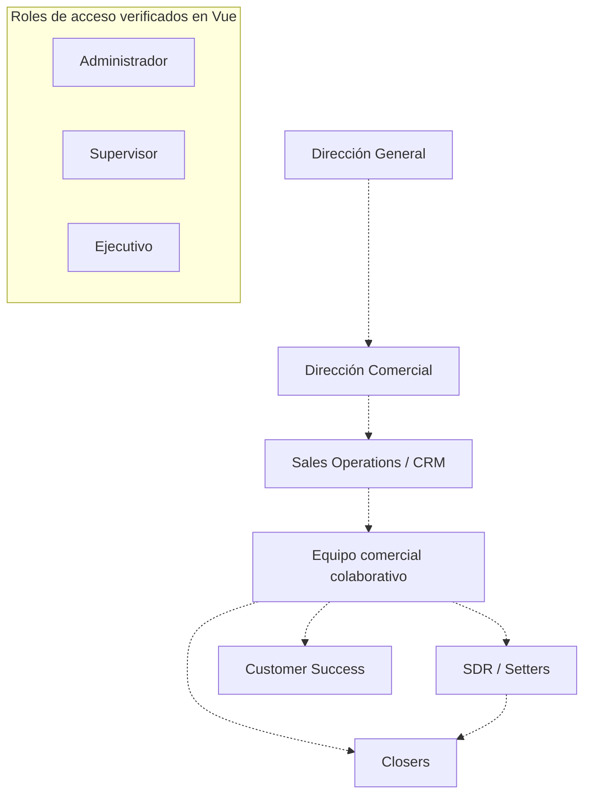
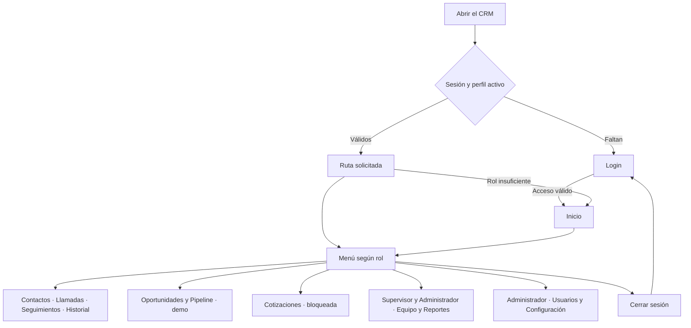
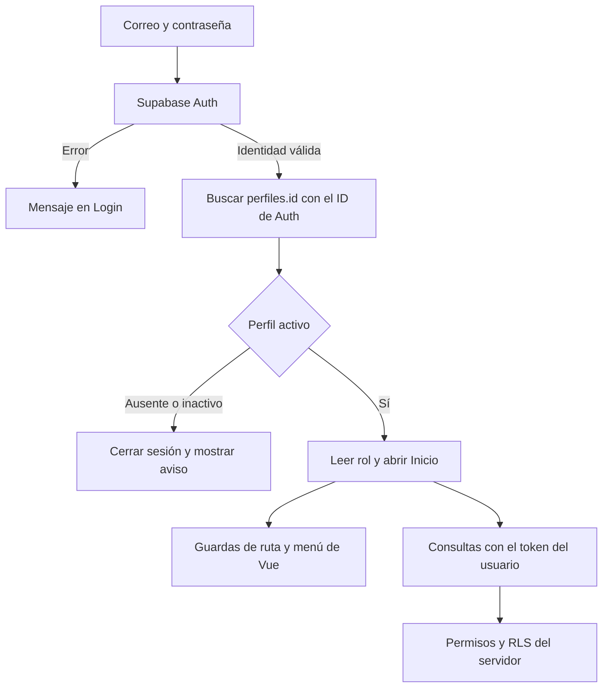
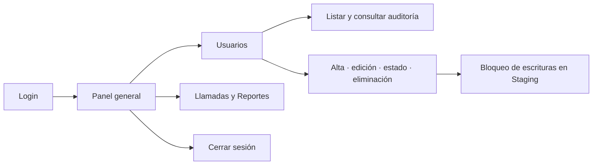
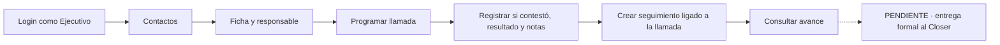
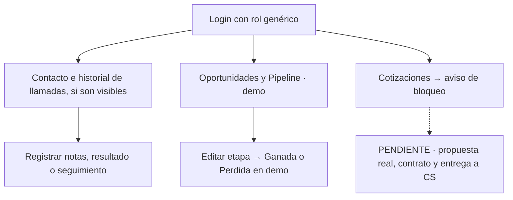
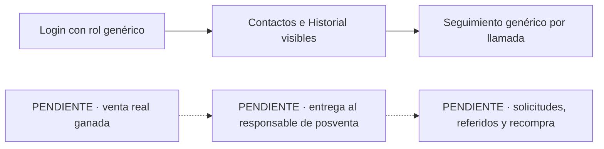
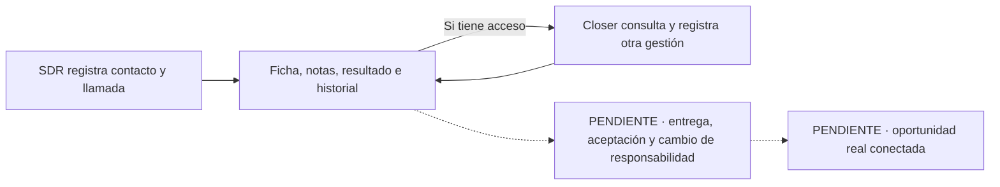
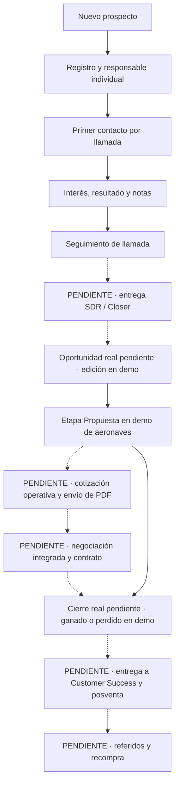
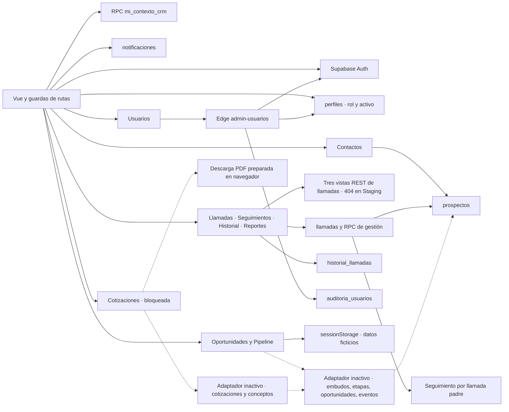

# MANUAL DE ESTRUCTURA Y FUNCIONAMIENTO — CRM AVIACIÓN

**Fecha de revisión** 18 de noviembre de 2026 · **Rama** `main` · **Commit base** `e9640a4`

## 1. Resumen general del sistema

El CRM es una aplicación web Vue 3 con autenticación y servicios de Supabase. Su flujo comercial conectado se concentra en una ficha de contacto y las llamadas asociadas. Oportunidades y Pipeline funcionan con datos de demostración en la sesión del navegador. Cotizaciones muestra un bloqueo en la navegación normal, incluso con la variable de modo en `demo`. El código incluye un generador de PDF, pero desde esa pantalla bloqueada no se puede crear una cotización ni descargar su PDF.

En Staging, la API devolvió **404 PGRST205** para las tres vistas que necesita la carga general de llamadas. Si el usuario entra con una cuenta activa, el código intenta consultar esas vistas y cualquier fallo de esas consultas activa el mensaje general **No fue posible cargar el CRM**. Esto afecta también a Contactos, aunque `prospectos` sea un recurso reconocido por la API. Oportunidades, Cotizaciones y Usuarios se renderizan por separado del mensaje general y tienen sus propios servicios. No se realizó una sesión autenticada para observar el incidente en pantalla.

**Alcance.** Se inspeccionó el árbol local de `main`, incluidas las modificaciones preexistentes sin commit para Staging. El commit base difiere en los scripts de Vite, la selección de proyecto, los bloqueos de escritura y el tratamiento de errores de login. Los resultados remotos se limitan a solicitudes GET con la clave pública del proyecto Staging, sin sesión de usuario y con cero filas solicitadas. No se consultó Producción, no se ejecutó SQL ni se probaron escrituras. El único archivo incorporado por esta revisión es este manual. Pasaron 26 pruebas locales seleccionadas de rutas, contactos, métricas, oportunidades, cotizaciones y PDF. Los guardados de esas pruebas usaron dobles locales y no escribieron en Supabase.

| Estado | Interpretación |
| --- | --- |
| IMPLEMENTADO | Existe un recorrido en el código con pantalla y respuesta definida. La disponibilidad remota se indica aparte. |
| PARCIAL | Existen piezas, pero el recorrido visible, la integración o la disponibilidad está incompleta. |
| MODO DEMO | Se trabaja con datos ficticios y persistencia local. |
| PENDIENTE | El recorrido o transición solicitados carecen de implementación operativa identificada. |
| NO VERIFICABLE | La evidencia disponible no permite confirmar el resultado remoto o los permisos efectivos. |

## 2. Organigrama, roles y permisos

### Diagrama 1. Estructura organizacional

Las líneas punteadas del organigrama representan la estructura de negocio solicitada, pendiente de confirmar como configuración efectiva del CRM. SDR y Closer son funciones de un mismo equipo.

| Elemento | Evidencia y estado |
| --- | --- |
| Cargo comercial, departamento y línea de mando | **PENDIENTE en la interfaz.** El acceso consulta `perfiles.rol` y `activo`. El formulario de Usuarios ofrece rol y estado junto a datos personales. El campo cargo de Contactos corresponde al prospecto. |
| Departamentos, puestos, equipos y miembros | **PARCIAL.** Staging reconoció las rutas REST `departamentos`, `puestos`, `equipos` y `equipo_miembros`, pero denegó acceso anónimo. Usuarios no ofrece asignarlos y Equipo abre un marcador de preparación. Contenido, vínculos y jerarquía efectivos **NO VERIFICABLES**. |
| Contexto CRM | `mi_contexto_crm` se llama durante la carga general. Su respuesta se almacena en `estado.contexto`. Menú y guardas deciden con el rol de perfil. Contenido y reglas de la RPC en Staging **NO VERIFICABLES**. |
| Ejecutivo | Menú comercial común. En las pestañas personales de llamadas, Vue filtra por asignado o creador según la pestaña. Los selectores de responsables de contactos y llamadas reciben el perfil actual para este rol. La carga general y demás consultas dependen del alcance que conceda el servidor. |
| Supervisor | Menú comercial común más Equipo y Reportes. En los formularios compartidos puede escoger entre perfiles activos visibles, excluyendo administradores. La interfaz usa un supervisor genérico y carece de una pantalla que muestre su cartera de subordinados. |
| Administrador | Incluye Equipo, Reportes, Usuarios y Configuración. Usuarios permite gestionar tres roles fijos, sujeto a la función remota y a los bloqueos de Staging. Configuración muestra un marcador de preparación. |

Referencias: [guardas de rutas](../src/router/index.js), [menú por rol](../src/lib/crmNavigation.js), [carga de contexto y filtros](../src/composables/useCrm.js), [selectores y shell](../src/views/CrmShellView.vue), [formulario administrativo](../src/views/UsuariosAdminView.vue).

## 3. Navegación e inicio de sesión

1. Al abrir el CRM, Vue Router comprueba si hay una sesión. Al abrir una ruta protegida sin sesión redirige a `/login`. Una sesión válida permite abrir directamente la ruta solicitada, salvo las restricciones de rol.
2. En Login, la persona introduce correo y contraseña, puede mostrar u ocultar la contraseña y envía el formulario. Supabase Auth verifica los datos con `signInWithPassword`. El formulario muestra la espera o el error, con código y estado HTTP cuando el árbol local los recibe.
3. La aplicación obtiene la identidad de Auth y busca `perfiles.id` con ese mismo identificador. Si falta el perfil o está inactivo, termina la sesión y muestra un aviso. Con perfil activo, el login lleva a Inicio `/` para cualquier rol.
4. El panel solicita usuario, perfil y contexto CRM, seguidos de contactos, usuarios activos, catálogos, llamadas y notificaciones. La barra lateral se arma por rol. En móvil, la barra inferior muestra las primeras cinco opciones.
5. Inicio o Panel general, Contactos, Oportunidades, Cotizaciones, Mis llamadas o Llamadas, Seguimientos e Historial son comunes. Supervisor y Administrador tienen Equipo y Reportes. Solo Administrador tiene Usuarios y Configuración en el menú. `/prospectos` redirige a Contactos. La acción Mi perfil abre Configuración, ruta autenticada que tampoco tiene pantalla funcional de edición.
6. Cerrar sesión llama a `signOut`, limpia el estado de autenticación y vuelve al login. El listener también redirige ante el evento de salida y vuelve a verificar el perfil al iniciar o renovar la sesión. Oportunidades de demo se guarda en `sessionStorage`, cuya limpieza no forma parte del cierre de sesión. 
7. `/establecer-acceso` es una ruta aparte para definir contraseña con una sesión de invitación. El flujo existe en código y su ejecución remota queda **NO VERIFICABLE**.

### Diagrama 2. Navegación general

### Diagrama 3. Inicio de sesión y permisos

Referencias: [LoginView e iniciarSesion](../src/views/LoginView.vue), [validarAccesoCrm, iniciarSesionConPassword y cerrarSesion](../src/composables/useAuthSession.js), [inicializarCrm](../src/composables/useCrm.js), [EstablecerAccesoView](../src/views/EstablecerAccesoView.vue).

## 4. Flujos por usuario

### Administrador

1. Entra por Login y llega a Panel general si su perfil está activo. El panel muestra indicadores de llamadas si termina la carga común. En Staging faltan las vistas REST requeridas por esa carga.
2. Abre **Usuarios** para ver el listado de cuentas. La pantalla solicita `listar` a `admin-usuarios`, revalida la sesión y admite recargar. **IMPLEMENTADO en código, NO VERIFICABLE en Staging** sin una sesión autenticada de administrador.
3. Selecciona **Nuevo usuario**, llena datos de identidad y contacto, fija rol y estado. La modalidad de invitación crea la identidad en Auth y sincroniza el perfil desde el backend. El alta con contraseña depende además de controles específicos. **PARCIAL en Staging**, donde ambas altas están bloqueadas por la configuración local.
4. Selecciona **Editar**, **Cambiar estado** o **Eliminar**. El código permite actualizar perfil y rol, activar o desactivar y solicitar eliminación definitiva con confirmación y comprobaciones. El backend sincroniza los cambios de acceso con Auth. El cambio de contraseña es una operación separada. **Bloqueados en Staging**.
5. Para permisos, selecciona uno de los tres roles predefinidos. **PENDIENTE** la edición granular por módulo, la asignación de puestos y departamentos, la administración de equipos y la asignación de supervisores desde la interfaz.
6. Consulta **Llamadas**, **Seguimientos**, **Historial** y **Reportes** para revisar actividad visible. Reportes calcula indicadores de llamadas. **PARCIAL** por la dependencia de las vistas faltantes y por su cobertura del proceso.
7. En Usuarios, **Historial de acciones** solicita registros de `auditoria_usuarios` con fecha, administrador, usuario, roles y estados anterior/nuevo. El diagnóstico es una acción de desarrollo local con restricciones propias. Disponibilidad autenticada **NO VERIFICABLE**.
8. Selecciona **Cerrar sesión** y vuelve a Login.

### Diagrama 4. Administrador

Referencias: [UsuariosAdminView](../src/views/UsuariosAdminView.vue), [crearUsuariosAdminNavegador](../src/services/usuariosAdminService.js), [contrato de operaciones](../src/services/usuariosAdminBackend.js), [ejecutor Auth y base de datos](../supabase/functions/_shared/adminUsuariosExecutor.js), [auditoría](../supabase/functions/_shared/adminUsuariosPostgres.js).

### SDR / Setter

1. Entra con su cuenta. El recorrido descrito corresponde a Ejecutivo si se le asigna ese rol. No existe una pantalla SDR diferenciada. Puede abrir contactos activos visibles para su sesión y su lista filtrada de llamadas.
2. En **Contactos → Nuevo contacto**, captura nombre y datos de comunicación, empresa, mercado, ubicación, aeronave de interés, presupuesto, prioridad y notas. El formulario avisa sobre posibles duplicados entre los registros cargados. Al guardar, la aplicación intenta insertar en `prospectos` y mostrar el registro confirmado. En Staging se bloquea el guardado.
3. El responsable se guarda en `usuario_responsable_id`; si no se indica, se usa el usuario autenticado. El Ejecutivo solo recibe su propio perfil como opción en el selector compartido. Para supervisión y administración se ofrecen perfiles visibles no administradores. **PENDIENTE** la recepción automática, la bandeja de entrada del SDR y el reparto por equipo.
4. Para registrar el primer contacto, abre **Programar llamada** desde la ficha o el encabezado, elige contacto, responsable, motivo, fecha, hora y prioridad. La llamada queda vinculada al contacto. Desde el detalle puede iniciar la gestión y registrar si contestó, resultado y notas. Las acciones de inicio y fin invocan RPC. La pantalla registra el trabajo, mientras la conversación ocurre fuera del CRM.
5. Registra interés con los campos de aeronave, presupuesto, prioridad y notas del contacto y con el resultado de la llamada. **PENDIENTE** una calificación comercial formal con criterios, estado y disparador de entrega al Closer.
6. Desde el detalle de la llamada programa un seguimiento con fecha, hora y responsable. El servicio envía `p_llamada_padre_id` a `crear_seguimiento_llamada`. **Seguimientos** agrupa llamadas por fechas y estado. Agendar una llamada tiene recorrido en código. Una agenda de reuniones con asistentes, invitaciones y sincronización externa queda **PENDIENTE**.
7. Revisa la ficha y el historial de llamadas. Para colaborar con el Closer puede usar el contacto y las llamadas como registro común si el Closer tiene permiso de lectura. Reasignar una llamada es una acción genérica disponible según su estado y los responsables visibles. La disponibilidad por equipo es **NO VERIFICABLE**. El sistema carece de entrega comercial, aceptación y criterio de fin de responsabilidad del SDR.

### Diagrama 5. SDR

Referencias: [ProspectosView](../src/views/ProspectosView.vue), [FormularioContacto](../src/components/FormularioContacto.vue), [FormularioLlamada](../src/components/FormularioLlamada.vue), [FormularioResultado](../src/components/FormularioResultado.vue), [crearProspecto, crearLlamada, finalizarLlamada y crearSeguimiento](../src/services/crmSupabaseService.js).

### Closer

1. Entra por el mismo Login y recibe el menú de su rol genérico. Si tiene visibilidad sobre el prospecto, puede revisar la ficha, sus llamadas y el historial de cada llamada. El historial global de llamadas y el de oportunidades son consultas separadas.
2. Registra conversaciones, objeciones o próximos pasos mediante notas, resultado y seguimiento de llamada. Son registros vinculados al contacto o a una llamada anterior. No se ha encontrado un vínculo operativo de esas llamadas a la oportunidad.
3. En **Oportunidades**, busca o filtra por embudo, servicio, etapa, responsable y demás criterios. Puede crear o actualizar una oportunidad y definir cliente, responsable, etapa, valor, moneda, prioridad y próximo seguimiento con datos ficticios. Guarda en la sesión del navegador y consulta el historial local del cambio.
4. En **Pipeline**, consulta tarjetas agrupadas por etapa. La edición de oportunidad permite moverla entre etapas y representar un cierre ganado o perdido. El demo de aeronaves ofrece Nueva, Propuesta, Ganada y Perdida. Motores, refacciones y vuelos privados tienen Nueva, Ganada y Perdida. El cierre local conserva fecha y el modelo demo admite motivo de pérdida.
5. Abre **Cotizaciones** y ve el aviso de persistencia bloqueada. El código preparado incluye conceptos, importes, vigencia, vista previa y descarga PDF desde una cotización guardada. El servicio demo existe para inyección, pero la navegación normal no lo selecciona. **PENDIENTE** elaborar, enviar o dar seguimiento a una propuesta real desde esta ruta.
6. Puede documentar una negociación en notas o llamadas si la base lo permite. El módulo de contratos, la aprobación formal, el cierre compartido en servidor y la entrega a Customer Success están **PENDIENTES**.

### Diagrama 6. Closer

Referencias: [ListaOportunidades](../src/modulos/oportunidades/vistas/ListaOportunidades.vue), [TableroOportunidades](../src/modulos/oportunidades/componentes/TableroOportunidades.vue), [crearServicioOportunidadesDemostracion](../src/modulos/oportunidades/servicios/servicioOportunidades.js), [ListaCotizaciones](../src/modulos/cotizaciones/vistas/ListaCotizaciones.vue), [crearCotizacionesNavegador](../src/modulos/cotizaciones/servicios/servicioCotizaciones.js).

### Customer Success

1. Puede iniciar sesión si ya tiene un perfil activo con un rol genérico. Recibe el mismo Inicio y menú del rol asignado. **PENDIENTE** un rol o pantalla propia de Customer Success.
2. Puede consultar Contactos e Historial si su sesión permite ver esos registros. La ficha corresponde a un prospecto. El estado Ganada del pipeline demo es local y no crea un cliente de posventa.
3. La recepción de una venta ganada, responsable, compromisos y documentos del Closer está **PENDIENTE**. No existe una bandeja que identifique ventas cerradas reales ni un traspaso automático.
4. Si dispone de acceso y las operaciones están habilitadas, puede registrar una llamada o seguimiento genérico para el contacto. No existe una actividad específica de posventa ni gestión de solicitudes o tickets del cliente.
5. El registro de referidos, origen de recompra y coordinación formal con SDR y Closer están **PENDIENTES**. Crear notas o una oportunidad de demo no establece esos vínculos.

### Diagrama 7. Customer Success

Referencias: [rutas disponibles](../src/router/index.js), [ProspectosView](../src/views/ProspectosView.vue), [SeguimientosView](../src/views/SeguimientosView.vue), [cierre local de oportunidad](../src/modulos/oportunidades/servicios/servicioOportunidades.js).

### Supervisores y Dirección

1. Cada puesto inicia sesión por la misma ruta y recibe Inicio, con las opciones que conceda su rol efectivo. El código no asigna automáticamente un rol a partir del puesto.
2. Quien entra como Supervisor puede abrir Reportes, revisar llamadas y seguimientos visibles, usar los formularios comerciales compartidos e intentar modificar o reasignar llamadas según su estado. Los selectores y menús no describen el alcance concedido por el servidor.
3. Quien entra como Administrador tiene además los controles de Usuarios. Los cambios de rol/estado son las autorizaciones administrativas implementadas en código. No hay una aprobación específica de ventas, descuentos, propuestas o contratos.

| Puesto solicitado | Pantalla, alcance, modificaciones y autorizaciones |
| --- | --- |
| Supervisor SDR | Con Supervisor ve Panel general, actividad telefónica, Reportes y el marcador Equipo. Puede revisar primer contacto y seguimiento solo sobre registros visibles. La lista nominal de SDR supervisados, la reasignación por equipo y las aprobaciones SDR están **PENDIENTES**. Alcance real **NO VERIFICABLE**. |
| Supervisor Closing | Con Supervisor ve las mismas pantallas y el pipeline de demo. Puede modificar oportunidades locales y usar las acciones genéricas de llamadas si tiene acceso. Carece de equipo Closing visible y de aprobación de propuestas, contratos o cierres. |
| Sales Operations / CRM | No tiene vista propia. Con Administrador puede abrir Usuarios, auditoría, Reportes y los módulos compartidos. Puede preparar cambios administrativos sujetos al servidor y editar etapas de demo desde Oportunidades. Carece de editor de políticas, organización y etapas productivas. |
| Director Comercial | Ve las pantallas del perfil que se le asigne. Con Supervisor o Administrador puede consultar Reportes de llamadas, revisar registros visibles y usar acciones genéricas. Carece de cartera consolidada, ingresos por embudo, relación de subordinados y autorizaciones comerciales específicas. |
| Dirección General | El acceso y la capacidad de modificación también dependen del perfil asignado. Con Administrador dispone de Usuarios y de los mismos reportes telefónicos. Carece de panel ejecutivo, vista jerárquica y autorizaciones de Dirección General modeladas en Vue. |

Referencias: [menú y roles](../src/lib/crmNavigation.js), [rutas Equipo, Reportes y Usuarios](../src/router/index.js), [acciones por estado de llamada](../src/components/AccionesLlamadaMenu.vue), [reportes y consultas](../src/composables/useCrm.js).

### Diagrama 8. Colaboración SDR ↔ Closer

## 5. Flujos por módulo

Cada recorrido indica cómo entrar, qué muestra la pantalla, qué hace el usuario, cómo responde el CRM y dónde quedan los datos. Los módulos ligados al shell comparten un mensaje de carga general si falla alguna dependencia, incluidas las vistas de llamadas ausentes en Staging.

| Módulo y propósito | Recorrido en pantalla | Datos, relaciones, errores y estado |
| --- | --- | --- |
| **Dashboard**. Priorizar llamadas | 1. Abrir Inicio o Panel general. 2. Ver pendientes, hoy, seguimiento, atrasadas, completadas y clasificación por mercado. 3. Abrir el detalle o programar una llamada. | Calcula indicadores y próxima llamada sobre información cargada. No crea una tabla de indicadores. Si falla la carga, muestra el error general. **PARCIAL en Staging**. [DashboardView](../src/views/DashboardView.vue), [indicadores](../src/composables/useCrm.js). |
| **Contactos y prospectos**. Mantener una ficha comercial | 1. Abrir Contactos. 2. Buscar y abrir la ficha, editar o crear. 3. Guardar o programar una llamada con la ficha preseleccionada. | Lee activos de `prospectos`; alta y edición escriben identidad, empresa, comunicación, mercado, interés, prioridades y responsable. El guardado confirmado actualiza la lista. Los avisos de duplicado usan los datos cargados y no certifican unicidad en la base. Un error de guardado se muestra en el formulario. **PARCIAL en Staging** por carga común y bloqueo. [ProspectosView](../src/views/ProspectosView.vue), [FormularioContacto](../src/components/FormularioContacto.vue), [crearContacto](../src/composables/useCrm.js). |
| **Empresas y clientes**. Identificar la organización y el contacto | 1. Abrir un contacto y ver Empresa y Cargo. 2. Editar ese dato desde la ficha. 3. En demo, seleccionar un cliente y ver su empresa en Oportunidades. | La empresa del contacto es texto en `prospectos.empresa`. El adaptador real de Oportunidades prepara un catálogo desde prospectos. El demo tiene clientes y empresas ficticios. La validación local verifica la relación demo. **PENDIENTE** el módulo autónomo con ficha de empresa o conversión de prospecto a cliente. [adaptador real](../src/modulos/oportunidades/adaptadores/adaptadorOportunidadesSupabase.js), [catálogo demo](../src/modulos/oportunidades/servicios/servicioOportunidades.js). |
| **Llamadas**. Programar y documentar conversaciones | 1. Abrir Llamadas o Mis llamadas y filtrar. 2. Programar con contacto, responsable y motivo. 3. Abrir detalle e iniciar, editar, reprogramar, reasignar o cancelar cuando el estado ofrece la acción. 4. Guardar resultado, respuesta y notas. | Consulta máximo 100 filas en la carga de lista sobre `vista_llamadas_detalle`. La tabla `llamadas` recibe los cambios directos. Inicio y fin usan `iniciar_llamada` y `finalizar_llamada`. Después de una respuesta exitosa se recargan datos e historial según la operación. Los errores de mutación se muestran como mensajes de operación. **PARCIAL en Staging**, sin vistas y con mutaciones bloqueadas. [LlamadasView](../src/views/LlamadasView.vue), [DetalleLlamadaDrawer](../src/components/DetalleLlamadaDrawer.vue), [servicio](../src/services/crmSupabaseService.js). |
| **Seguimientos**. Organizar la siguiente llamada | 1. Abrir el detalle de una llamada y crear seguimiento. 2. Elegir nueva fecha, hora, responsable, motivo y prioridad. 3. Abrir Seguimientos y ver grupos de hoy, próximas, atrasadas y completadas. | La RPC `crear_seguimiento_llamada` recibe el identificador de la llamada padre; se recargan listas y detalle cuando se confirma. El error se muestra en la operación. **PARCIAL en Staging**, con relación a llamada y contacto. Integración con oportunidad o fase posventa **PENDIENTE**. [SeguimientosView](../src/views/SeguimientosView.vue), [crearSeguimiento y seguimientoAgrupado](../src/composables/useCrm.js). |
| **Oportunidades**. Llevar una posibilidad de venta | 1. Abrir Oportunidades, filtrar o crear. 2. Completar cliente, responsable, embudo, etapa, importe, moneda, prioridad y fecha de próximo seguimiento. 3. Guardar y revisar historial. | **MODO DEMO** en `sessionStorage` o memoria. Devuelve el registro actualizado y su historial local. Reporta errores de validación, edición desactualizada o almacenamiento. El adaptador real consulta `prospectos`, `perfiles`, `embudos`, `etapas`, `oportunidades` y `eventos_oportunidad`, y prepara RPC de alta/edición. Está deshabilitado. [ListaOportunidades](../src/modulos/oportunidades/vistas/ListaOportunidades.vue), [servicio](../src/modulos/oportunidades/servicios/servicioOportunidades.js), [configuración](../src/modulos/oportunidades/esquemas/contratoOportunidadesSupabase.js). |
| **Pipeline**. Visualizar ventas por etapa | 1. Abrir Oportunidades y elegir Pipeline. 2. Elegir filtros y abrir una tarjeta. 3. Cambiar etapa desde el formulario y guardar. La pantalla reorganiza las tarjetas según lo guardado. | Comparte datos y validaciones con Oportunidades. Permite administrar etapas locales con reglas de nombre, orden y compatibilidad. Un fallo muestra aviso y evita confirmar el cambio. **MODO DEMO**. [TableroOportunidades](../src/modulos/oportunidades/componentes/TableroOportunidades.vue), [FormularioOportunidad](../src/modulos/oportunidades/componentes/FormularioOportunidad.vue), [guardarEtapa](../src/modulos/oportunidades/servicios/servicioOportunidades.js). |
| **Cotizaciones**. Preparar una propuesta económica | 1. Abrir Cotizaciones. 2. Ver aviso de bloqueo y listado sin registros. El formulario y el botón de alta dependen de un servicio operativo. | **PARCIAL**, con formulario, filtros y cálculo previstos, sin consultas al catálogo real en el modo vigente. El adaptador contempla `cotizaciones`, `cotizacion_conceptos` y RPC `crear_cotizacion` y `actualizar_cotizacion`. Liga cotización con oportunidad y prospecto y relee el guardado. La vista contiene manejo de errores y de confirmación incierta. El modo demo solo se utiliza si se inyecta ese servicio. [ListaCotizaciones](../src/modulos/cotizaciones/vistas/ListaCotizaciones.vue), [adaptador](../src/modulos/cotizaciones/adaptadores/adaptadorCotizacionesSupabase.js), [contrato y controles](../src/modulos/cotizaciones/esquemas/contratoCotizacionesSupabase.js). |
| **PDF**. Descargar la cotización | 1. En el flujo preparado, guardar la cotización. 2. Abrir la vista previa guardada. 3. Elegir descargar y esperar la confirmación de inicio de descarga. En la ruta actual no se llega a estos pasos. | jsPDF genera un archivo en el navegador a partir de la cotización y sus partidas, con recursos de marca. La generación demo incluye su identificación. Un fallo muestra un aviso y permite volver a intentar. **PARCIAL**, generador disponible en código y descarga inaccesible en el flujo normal vigente. [VistaPreviaCotizacion](../src/modulos/cotizaciones/componentes/VistaPreviaCotizacion.vue), [generador](../src/modulos/cotizaciones/utilidades/cotizacionPdf.js). |
| **Usuarios**. Administrar accesos | 1. Entrar como administrador y abrir Usuarios. 2. Consultar, recargar o abrir una acción individual. 3. En un entorno habilitado, editar o dar de alta y esperar confirmación. | Función Edge `admin-usuarios`, Supabase Auth, `perfiles` y auditoría. Si falla la sesión, despliegue o confirmación, la pantalla informa del problema. Las lecturas están implementadas en código, la operación autenticada en Staging queda **NO VERIFICABLE** y las escrituras quedan bloqueadas. [vista](../src/views/UsuariosAdminView.vue), [cliente administrativo](../src/services/usuariosAdminBackend.js). |
| **Departamentos**. Representar áreas | 1. Buscar departamentos desde Usuarios o Equipo. La app no ofrece formulario ni listado de departamentos. | Staging reconoce `departamentos` con acceso anónimo denegado. Vue no consulta ni guarda catálogos o asignaciones de esta entidad. **PENDIENTE** la gestión en interfaz y **NO VERIFICABLE** su contenido remoto. [Formulario de Usuarios](../src/views/UsuariosAdminView.vue), [shell](../src/views/CrmShellView.vue). |
| **Puestos**. Identificar cargo interno | 1. Abrir Usuarios. 2. El selector disponible cambia el rol de acceso. | Staging reconoce `puestos`, con acceso anónimo denegado. La operación de Usuarios envía rol y estado, y carece de selector de puesto. **PENDIENTE** la gestión en interfaz y **NO VERIFICABLE** su contenido remoto. [dominio administrativo](../src/domain/usuariosAdmin.js), [formulario](../src/views/UsuariosAdminView.vue). |
| **Equipos**. Organizar membresías y supervisión | 1. Entrar como Supervisor o Administrador. 2. Abrir Equipo y ver el marcador de preparación si carga el shell. | Staging reconoce `equipos` y `equipo_miembros`, con acceso anónimo denegado. La ruta no ofrece altas, cambios o asignación de miembros o supervisor. **PARCIAL** por ruta y recursos remotos, con membresías reales **NO VERIFICABLES**. [router](../src/router/index.js), [PlaceholderView](../src/views/PlaceholderView.vue). |
| **Notificaciones**. Cargar avisos personales | 1. Al entrar, el shell solicita las notificaciones del usuario. 2. El servicio contempla volver a cargarlas ante cambios Realtime. La navegación revisada carece de bandeja o botón de lectura. | Consulta `notificaciones` por usuario y hay una RPC `marcar_notificacion_leida` que el bloqueo local permite. Un error al cargar puede activar el error general. **PARCIAL**. Datos, eventos y operación de la RPC **NO VERIFICABLES**. [useCrm](../src/composables/useCrm.js), [servicio](../src/services/crmSupabaseService.js). |
| **Reportes**. Revisar volumen y resultados de llamadas | 1. Abrir Reportes como Supervisor o Administrador. 2. Consultar registradas, contestadas, no contestadas, pendientes, atrasadas, completadas, duración promedio y llamadas que requieren seguimiento. | Usa el resumen de hasta 200 filas y la vista de vencidas. Las respuestas se cuentan según el valor explícito de `contesto`. Se calculan en el navegador, sin guardar un reporte separado. El error común impide ver resultados. **PARCIAL**, sin ventas, exportación visible o consolidado comercial. [ReportesView](../src/views/ReportesView.vue), [métricas](../src/lib/crmMetrics.js), [reportes](../src/composables/useCrm.js). |
| **Auditoría e historial**. Consultar registros y cambios | 1. Abrir Historial para una tabla de llamadas, con fecha, contacto, resultado, duración y notas. 2. Abrir detalle de llamada para eventos. 3. En Usuarios, abrir Historial de acciones. 4. En Oportunidades, abrir historial del registro demo. | La tabla general usa el resumen de llamadas. El detalle consulta `historial_llamadas`; Usuarios consulta `auditoria_usuarios` mediante la función Edge, con límite de 200. Oportunidades usa eventos locales y el adaptador real prevé `eventos_oportunidad`. El error de carga de cada origen afecta su vista, y el de las llamadas puede afectar el shell. **PARCIAL**, con historial comercial unificado **PENDIENTE**. [HistorialView](../src/views/HistorialView.vue), [historial por llamada](../src/components/HistorialLlamada.vue), [auditoría administrativa](../supabase/functions/_shared/adminUsuariosPostgres.js). |

El servicio de llamadas incluye lecturas y operaciones de archivos en Storage junto con metadatos en `imagenes_llamadas`. El recorrido de detalle revisado no expone una gestión de adjuntos con esos métodos. [crmSupabaseService](../src/services/crmSupabaseService.js), [DetalleLlamadaDrawer](../src/components/DetalleLlamadaDrawer.vue).

## 6. Proceso comercial completo

| Paso | Responsable y colaboración | Resultado y estado |
| --- | --- | --- |
| 1. Nuevo prospecto y registro | SDR o usuario comercial con acceso | Captura manual en Contactos y persistencia prevista en `prospectos`. Entrada automática **PENDIENTE**. Guardado bloqueado en Staging. |
| 2. Asignación SDR | Usuario que registra, Supervisor o Administrador según permisos | Responsable individual de ficha o de llamada. La asignación por cargo, por equipo o por reglas está **PENDIENTE**. |
| 3. Primer contacto | SDR | Programa la llamada y registra respuesta, resultado y notas. Flujo genérico **IMPLEMENTADO** en código. Staging bloquea escrituras y carece de las vistas REST que lo alimentan. |
| 4. Calificación | SDR con apoyo del Closer según práctica comercial | Interés, presupuesto, prioridad, notas y resultado de llamada. Criterio de calificación y paso automático **PENDIENTES**. |
| 5. Seguimiento | SDR o responsable elegido | Nueva llamada ligada a la anterior. **IMPLEMENTADO** en código y bloqueado en Staging. Reuniones con calendario **PENDIENTES**. |
| 6. Colaboración | SDR y Closer | Pueden operar sobre el mismo registro si ambos lo ven. Entrega formal, aceptación y aviso de transición **PENDIENTES**. |
| 7. Oportunidad | Closer, con contexto del SDR | **MODO DEMO**. El contacto real no genera automáticamente una oportunidad. El enlace real por `prospecto_id` está preparado en el adaptador inactivo. |
| 8. Propuesta y cotización | Closer | Etapa Propuesta en el embudo demo de aeronaves. Cotización y PDF reales bloqueados. Envío y seguimiento de propuesta **PENDIENTES**. |
| 9. Negociación y contrato | Closer, con eventual supervisión | Conversaciones en notas o llamadas si son accesibles. Aprobaciones, historial de negociación integrado y contratos **PENDIENTES**. |
| 10. Cierre ganado o perdido | Closer | Estado y fecha en **MODO DEMO**. Persistencia y flujo de cierre real **PENDIENTES**. |
| 11. Entrega a CS y posventa | Closer entrega y Customer Success recibe según proceso de negocio | Traspaso y gestión de posventa **PENDIENTES**. El contacto admite el uso genérico de llamadas y seguimientos. |
| 12. Referidos y recompra | Customer Success colabora con SDR y Closer | Registro estructurado y devolución al pipeline **PENDIENTES**. |

### Diagrama 9. Del prospecto a posventa

Las flechas continuas indican recorridos presentes en código. El bloque de llamadas tiene las restricciones de Staging descritas arriba. Las punteadas señalan transiciones en las que todavía falta integrar datos o etapas reales.

## 7. Integración y comprobaciones de Supabase

1. `npm run dev:staging` ejecuta `vite --mode staging` en el árbol local. El cliente exige el identificador `cpwknzvrikuapsrsybka` de **red-aviation-staging** en ese modo. Para `development` y `production` exige `hhlicjgpwcesytziacvc`, **red-aviation**. Una URL que no corresponda al modo detiene la inicialización.
2. Vue usa un cliente compartido de Supabase con clave pública, sesión persistente, renovación de token y detección de sesión en URL. Contactos, perfiles, catálogos, contexto, llamadas, historial y notificaciones tienen consultas reales en código. Usuarios usa la función Edge con el token de sesión. Oportunidades y Pipeline son demo en esta configuración efectiva. Cotizaciones está bloqueada.
3. La configuración local efectiva indica `VITE_CRM_STAGING_WRITES_ENABLED=false`. El cliente bloquea mutaciones REST y RPC comerciales, peticiones mutantes a Edge Functions y cambios de objetos en Storage excepto firma. Contactos, llamadas y la administración añaden comprobaciones previas en sus servicios. Las lecturas administrativas `listar` e `historial` son POST de aplicación mediante un fetch propio y quedan permitidas por ese control local. Auth y las RPC `mi_contexto_crm` y `marcar_notificacion_leida` quedan exceptuadas. Por ello el bloqueo cubre las escrituras comerciales del cliente y aún permite operaciones de sesión y de cuenta cuando Auth las autoriza.
4. El control Vue decide la ruta y los selectores. PostgREST y PostgreSQL deciden qué puede consultar o modificar cada token mediante privilegios y políticas de fila (RLS). Las RPC pueden aplicar reglas propias; su firma, permisos y lógica remota quedan **NO VERIFICABLES**. El código de la función administrativa comprueba identidad y perfil administrador activo antes de su trabajo con Auth y PostgreSQL. Despliegue y permisos efectivos **NO VERIFICABLES**.
5. Se consultó el endpoint REST de Staging con GET y `limit=0`. No había un token autenticado de administrador disponible para la inspección. La prueba establece lo siguiente.

| Evidencia remota | Qué permite concluir |
| --- | --- |
| **401 / 42501** en `departamentos`, `puestos`, `equipos`, `equipo_miembros`, `perfiles`, `prospectos`, `llamadas`, `catalogo_motivos_llamada`, `catalogo_resultados_llamada`, `historial_llamadas`, `imagenes_llamadas`, `notificaciones`, `auditoria_usuarios`, `embudos`, `etapas`, `oportunidades`, `eventos_oportunidad`, `cotizaciones` y `cotizacion_conceptos`. | PostgREST reconoció esos nombres y denegó la petición anónima. No se confirmaron filas, relaciones, políticas ni alcance por rol autenticado. |
| **404 / PGRST205** en `vista_llamadas_detalle`, `vista_llamadas_hoy` y `vista_llamadas_vencidas`. | Esos nombres no están disponibles en la caché de esquema REST consultada. Puede deberse al esquema expuesto, a configuración/caché o a la ausencia de las vistas. La causa en PostgreSQL no se inspeccionó. Son dependencias directas de la carga común. |
| **404 / PGRST205** en `clientes`, `empresas`, `contratos`, `usuarios_equipos` y `etapas_embudo`. | Esos nombres concretos no están disponibles por ese endpoint. El código usa `etapas` y Staging reconoce `equipo_miembros`. La prueba no descarta otros nombres ni recursos no expuestos. |

La carga común usa `await Promise.all`. Un error al consultar las vistas activa el estado de error incluso si otras consultas como `prospectos` responden. Realtime se inicia después de la carga inicial exitosa. Por este motivo, habilitar el indicador de escrituras por sí solo no restablecería la operación de contactos, llamadas o reportes.

### Diagrama 10. Relación entre módulos y datos

Referencias: [scripts](../package.json), [cliente Supabase](../src/lib/supabase.js), [bloqueo Staging](../src/lib/stagingWriteProtection.js), [consultas comerciales](../src/services/crmSupabaseService.js), [SQL de diagnóstico existente, sin ejecutar](sql/diagnostico-integracion-crm.sql).

## 8. Funcionalidades operativas, parciales y faltantes

- **IMPLEMENTADO en código:** login por correo y contraseña, verificación de perfil activo, navegación por rol y cierre de sesión. También existen las operaciones de contacto, llamada, resultado, seguimiento y administración descritas. La revisión no realizó un login real.
- **MODO DEMO operativo en el código de la ruta normal:** Oportunidades, Pipeline, etapas configurables e historial local. Los cambios pertenecen a la sesión del navegador y el catálogo trae datos ficticios. El servicio demo de Cotizaciones no es el servicio de esa ruta.
- **PARCIAL:** inicialización del panel y módulos telefónicos en Staging, administración de usuarios con escrituras bloqueadas, notificaciones sin bandeja, informes telefónicos, historiales separados y cotizaciones/PDF preparados con acceso bloqueado.
- **PENDIENTE:** organigrama administrable, asignación de departamentos, puestos, equipos y supervisores en Vue, calificación formal, agenda de reuniones, entrega SDR/Closer, pipeline compartido, cotización y contrato operativos, cierre real, entrega a Customer Success, solicitudes, referidos, recompra e historial comercial unificado.
- **NO VERIFICABLE en esta revisión:** cuentas y jerarquía cargadas en Staging, políticas RLS y privilegios autenticados, visibilidad cruzada entre SDR y Closer, despliegue efectivo de `admin-usuarios`, ejecución de RPC con sesiones reales y estado operativo en producción.

## 9. Conclusión y próximos pasos

1. Revisar en Staging las tres vistas REST de llamadas y la RPC de contexto con diagnóstico de solo lectura. Comparar esquema expuesto, caché, privilegios y definición con las consultas del cliente. Después, verificar si el shell puede cargar cada módulo y si un fallo de llamadas debería impedir abrir Contactos.
2. Confirmar el organigrama y los permisos con metadatos de PostgreSQL y sesiones de lectura de Administrador, Supervisor y Ejecutivo. Comparar rol de acceso, puesto, departamento, membresía, supervisor y visibilidad efectiva sobre prospectos, llamadas y oportunidades.
3. Definir la entrega SDR/Closer sobre la ficha compartida, con responsable vigente y visibilidad de historial. Validar primero la relación real `prospectos → oportunidades → cotizaciones` y el contrato de ambos adaptadores.
4. Definir qué evento de venta ganada inicia posventa, qué contexto recibe Customer Success y cómo se relacionan solicitudes, referidos y recompra con el cliente original.

El punto de partida para Dirección es la ficha de prospecto con su actividad telefónica. El cierre, la cotización y la posventa todavía carecen de un recorrido común y persistido accesible desde la aplicación revisada.
