# CRM Aviación · Mapa general, estructura y flujos del sistema

## 1. Resumen ejecutivo

El sistema organiza la atención comercial de contactos de aviación en mercados nacionales e internacionales. Su recorrido principal conecta el registro del contacto con la programación de llamadas, su asignación, el registro del resultado y la programación de una llamada posterior. Los datos alimentan el panel, el historial y los reportes. El tablero de oportunidades actualmente abre en demostración y la ruta normal de cotizaciones muestra un bloqueo de persistencia. Equipo y Configuración existen como destinos de navegación con contenido genérico.

El análisis corresponde al árbol de trabajo actual, incluidas las modificaciones locales preexistentes. Se inspeccionaron rutas, vistas, formularios, servicios, validaciones, configuración y código de la función administrativa. `npm test` ejecutó 221 casos: 218 aprobados, 3 omitidos y 0 fallidos. Se evaluó el comportamiento local mediante las pruebas existentes. Las operaciones remotas, la entrega de invitaciones, las políticas vigentes y el despliegue quedan sin verificación en esta revisión. No se realizaron escrituras remotas.

Evidencia principal. [Rutas](../src/router/index.js) · [Interfaz principal](../src/views/CrmShellView.vue) · [Pruebas](../tests/) · [Servicios](../src/services/)

## 2. Mapa general del sistema

| Área | Entradas | Salidas o destinos |
|---|---|---|
| Acceso | Correo y contraseña, invitación, sesión existente | Panel, pantalla de contraseña o mensaje de acceso |
| Operación de llamadas | Contacto, responsable, motivo, fecha, resultado y notas | Llamada, seguimiento, historial y estadísticas |
| Gestión comercial | Contacto y oportunidad según el catálogo del modo activo | Tablero de oportunidades de demostración. Cotizaciones bloqueadas en el recorrido normal |
| Supervisión | Llamadas visibles y resultados | Indicadores y reportes. Equipo muestra una vista genérica |
| Administración | Datos del perfil, rol, estado, confirmaciones y modalidad de alta | Cuenta y perfil, cambios administrativos, historial o aviso de revisión |
| Configuración | Enlace del menú o «Mi perfil» | Vista genérica |

Evidencia. [Menú](../src/lib/crmNavigation.js) · [Rutas](../src/router/index.js) · [Selección de vistas](../src/views/CrmShellView.vue)

## 3. Arquitectura funcional

El CRM tiene una entrada por cuenta y un menú que varía según el rol. Contactos y Llamadas concentran la captura operativa. Seguimientos reorganiza las llamadas existentes por fecha y estado. Historial muestra una tabla de llamadas y el detalle de una llamada abre su propia bitácora. Reportes resume el conjunto visible para el usuario. Oportunidades, Cotizaciones y Usuarios tienen pantallas y servicios propios dentro del mismo marco de navegación.

La autorización se observa en tres puntos: la ruta habilita pantallas por rol, los formularios determinan qué opciones presenta la interfaz y Supabase decide qué datos y operaciones acepta. Una pantalla abierta puede seguir dependiendo de catálogos, permisos u operaciones disponibles en el proyecto conectado.

Evidencia. [Contenedor](../src/views/CrmShellView.vue) · [Estado del CRM](../src/composables/useCrm.js) · [Sesión](../src/composables/useAuthSession.js)

## 4. Tipos de usuarios

| Perfil | Acceso y alcance observable |
|---|---|
| Ejecutivo | Inicio, Contactos, Oportunidades, Cotizaciones, Mis llamadas, Seguimientos e Historial. La interfaz limita el selector de responsables a sí mismo y presenta la operación individual. El alcance real sobre filas depende de Supabase |
| Supervisor | Secciones operativas más Reportes y Equipo. La interfaz ofrece perfiles activos como candidatos de asignación. El alcance exacto sobre un equipo requiere comprobar las políticas remotas |
| Administrador | Secciones del supervisor más Usuarios y Configuración en el menú. La administración comprueba identidad, rol y estado activo en el servidor |
| Visitante o cuenta sin acceso CRM | Puede abrir Inicio de sesión y la pantalla de establecimiento de contraseña. El área CRM requiere sesión y perfil activo |

Las tres claves efectivas son `ejecutivo`, `supervisor` y `administrador`. Configuración exige autenticación en el router y «Mi perfil» navega allí. La restricción al administrador corresponde al menú, mientras que Equipo y Reportes tienen una restricción explícita de ruta. Las funciones comerciales de SDR, closer y posventa mencionadas en otros documentos carecen de un rol propio en el código auditado.

Evidencia. [Navegación](../src/lib/crmNavigation.js) · [Guardia de rutas](../src/router/index.js) · [Selectores y Mi perfil](../src/views/CrmShellView.vue) · [Administración](../supabase/functions/admin-usuarios/index.ts)

## 5. Flujo de acceso

1. El administrador abre **Usuarios → Nuevo usuario** y captura nombre, apellidos, correo, teléfono, rol y estado. El alta contempla invitación y, bajo habilitación específica, creación con contraseña. El registro autónomo queda pendiente en la aplicación.
2. En la modalidad por invitación, el servidor solicita el envío a Supabase Auth con una URL autorizada. El enlace conduce a `/establecer-acceso`. La vista exige una identidad válida de Auth, exige al menos 12 caracteres con confirmación coincidente, actualiza la contraseña e intenta abrir el panel mediante la guardia normal. El enlace, la entrega y la activación dependen del entorno.
3. En `/login`, el usuario entrega correo y contraseña. Supabase Auth autentica las credenciales. El cliente consulta la identidad y busca el perfil con el mismo identificador en `perfiles`.
4. El perfil aporta el rol y debe tener `activo = true`. Un perfil ausente o inactivo devuelve al usuario a Login con un mensaje; las credenciales inválidas se muestran como error.
5. Tras iniciar sesión se abre `/`, con Inicio para el ejecutivo y Panel general para el supervisor y el administrador. Una sesión existente permite abrir una URL protegida si satisface la guardia. Una ruta restringida a otro rol vuelve al panel.
6. Se navega con el menú lateral y, en móvil, con los primeros cinco accesos disponibles. Los cambios de sesión y la renovación del token provocan una revisión del acceso.
7. **Cerrar sesión** llama a Auth, limpia el estado de sesión de la aplicación y vuelve a `/login`.

Evidencia. [Login](../src/views/LoginView.vue) · [Establecer acceso](../src/views/EstablecerAccesoView.vue) · [Sesión](../src/composables/useAuthSession.js) · [Alta administrativa](../supabase/functions/_shared/adminUsuariosExecutor.js)

## 6. Estructura de módulos y submódulos

En esta tabla, **Todos** significa los tres roles con perfil activo. El conjunto de registros depende de la cuenta y del backend.

| Módulo y pantalla | Acceso | Entradas, acciones, conexiones y resultado | Código |
|---|---|---|---|
| Inicio o Panel general `/` | Todos | Recibe llamadas y agregados. Muestra indicadores, resumen y próxima llamada. Permite programar y abrir acciones operativas. La salida es una vista de prioridades y acceso a Llamadas | [DashboardView](../src/views/DashboardView.vue) |
| Contactos `/contactos` | Todos | Lista, búsqueda, filtros, ficha y formulario de alta o edición. Recibe identidad, empresa, datos de contacto, mercado e interés de aviación, prioridad y responsable. Comprueba duplicados visibles y permite abrir una coincidencia. Guarda en `prospectos` y permite iniciar una llamada con el contacto preseleccionado. `/prospectos` redirige aquí | [ProspectosView](../src/views/ProspectosView.vue) · [Formulario](../src/components/FormularioContacto.vue) · [Datos del contacto](../src/domain/contactoPayload.js) |
| Llamadas `/llamadas` | Todos | Pestañas y filtros, tabla y tarjetas móviles, detalle, resultado y bitácora. Recibe contacto, responsable, fecha y hora, motivo, prioridad y descripción. Permite programar, editar campos, iniciar, finalizar, reprogramar, reasignar y cancelar según el estado y los permisos. Devuelve la llamada actualizada y refresca listados | [LlamadasView](../src/views/LlamadasView.vue) · [Detalle](../src/components/DetalleLlamadaDrawer.vue) · [Acciones](../src/components/AccionesLlamadaMenu.vue) · [Formulario](../src/components/FormularioLlamada.vue) |
| Seguimientos `/seguimientos` | Todos | Agrupa llamadas en Hoy, Próximas, Atrasadas y Completadas. Abre su detalle. La acción de crear seguimiento vive en el detalle y remite llamada padre, nueva fecha, asignado y datos complementarios. El resultado esperado es una llamada vinculada a la anterior | [SeguimientosView](../src/views/SeguimientosView.vue) · [Servicio](../src/services/crmSupabaseService.js) |
| Historial `/historial` | Todos | Presenta fecha programada, contacto, mercado, resultado, duración y notas. Supervisor y administrador ven la columna responsable. Usa el resumen compartido, que puede incluir llamadas pendientes. La bitácora de eventos por llamada se abre desde su detalle | [HistorialView](../src/views/HistorialView.vue) · [Bitácora](../src/components/HistorialLlamada.vue) |
| Reportes `/reportes` | Supervisor y administrador | Lee el resumen visible, calcula llamadas registradas, contestadas, no contestadas, pendientes, atrasadas y duración promedio, entre otros indicadores. Produce tarjetas informativas a partir de los registros ya cargados | [ReportesView](../src/views/ReportesView.vue) · [Cálculos](../src/composables/useCrm.js) |
| Equipo `/equipo` | Supervisor y administrador | La ruta muestra la vista genérica. La selección de responsables se realiza en los formularios operativos | [Rutas](../src/router/index.js) · [Contenedor](../src/views/CrmShellView.vue) |
| Oportunidades `/oportunidades` | Todos | Tablero por embudo y etapa, filtros, ficha, formulario e historial de cambios. Usa cliente, título, descripción, responsable, etapa, valor, moneda, prioridad y fecha de siguiente contacto. Permite alta, edición, cambio de etapa e historial con datos de demostración en la sesión del navegador. El adaptador real está condicionado por configuración de staging | [ListaOportunidades](../src/modulos/oportunidades/vistas/ListaOportunidades.vue) · [Formulario](../src/modulos/oportunidades/componentes/FormularioOportunidad.vue) · [Servicio](../src/modulos/oportunidades/servicios/servicioOportunidades.js) |
| Cotizaciones `/cotizaciones` | Todos pueden abrir la ruta | El recorrido habitual muestra el bloqueo. La vista, con servicio operativo, admite lista, filtros, alta, edición de borrador, vista previa y PDF. Recibe oportunidad, moneda, vigencia y conceptos con cantidades y precios. El servicio real requiere oportunidades reales. El servicio de demostración existe como dependencia inyectable | [ListaCotizaciones](../src/modulos/cotizaciones/vistas/ListaCotizaciones.vue) · [Formulario](../src/modulos/cotizaciones/componentes/FormularioCotizacion.vue) · [Servicio](../src/modulos/cotizaciones/servicios/servicioCotizaciones.js) |
| Usuarios `/admin/usuarios`, alias `/usuarios` | Administrador activo | Listado y filtro, alta, edición, estado, eliminación, historial, recarga y diagnóstico con restricción local. Las pantallas de edición, estado y eliminación usan identificador. Puede invitar, cambiar datos, activar, desactivar y, si las condiciones se cumplen, eliminar. Incluye alta directa y cambio de contraseña bajo habilitación. Devuelve perfil confirmado, auditoría o indicación de resultado parcial | [UsuariosAdminView](../src/views/UsuariosAdminView.vue) · [Operaciones](../supabase/functions/_shared/adminUsuariosExecutor.js) |
| Configuración y Mi perfil `/configuracion` | Perfil activo. Entrada del menú para administrador | Pantalla genérica. La navegación «Mi perfil» conduce a esta ruta. La edición personal desde aquí queda pendiente | [Contenedor](../src/views/CrmShellView.vue) · [Vista genérica](../src/views/PlaceholderView.vue) |
| Notificaciones, servicio transversal | Usuario autenticado | Lee las notificaciones del usuario, actualiza el estado en memoria al recibir eventos y contiene una operación de marcar como leída. La interfaz auditada carece de bandeja y de conexión visible a esa acción | [Estado](../src/composables/useCrm.js) · [Servicio](../src/services/crmSupabaseService.js) |
| Imágenes de llamadas, servicio transversal | Sujeto al backend | Contiene consulta, carga, baja y firma de URLs para imágenes asociadas por llamada. El flujo visible del detalle carece de controles conectados para adjuntos | [Servicio](../src/services/crmSupabaseService.js) · [Detalle](../src/components/DetalleLlamadaDrawer.vue) |

## 7. Flujos individuales por usuario

### Ejecutivo

Inicia sesión y abre **Inicio**. Puede abrir una llamada asignada o buscar el contacto antes de programar una nueva. Si el contacto existe, usa la ficha. Si falta, lo registra, atendiendo el aviso de coincidencia cuando corresponda. Programa una llamada con su responsable disponible en el selector. Desde **Mis llamadas** abre el detalle y, cuando el estado lo permite, inicia la atención y guarda si hubo respuesta, el resultado y las notas. Si hace falta otro contacto, abre **Seguimientos** o programa el siguiente intento desde el detalle. Consulta su historial visible y cierra sesión. Puede explorar el tablero de demostración. Al abrir Cotizaciones encuentra el aviso de bloqueo actual.

### Supervisor

Inicia sesión y entra al **Panel general**. Revisa el trabajo visible en Llamadas, Seguimientos y Reportes. Si una llamada requiere cambio de responsable, abre la acción disponible y confirma un perfil activo. Al confirmarse el cambio, el registro conserva el contacto y sus datos operativos, y cambia el responsable. El nuevo responsable lo puede consultar según los permisos de datos. Si la atención sigue con la misma persona, el supervisor puede revisar su evolución en las listas y el detalle. Equipo lo lleva a la vista genérica. Finaliza mediante **Cerrar sesión**.

### Administrador

Entra al **Panel general** y puede seguir el recorrido operativo y de supervisión. En **Usuarios**, elige listar, invitar, editar, cambiar estado o consultar historial. Un alta puede transferir al invitado el paso de establecer su contraseña. Los cambios de estado y la baja tienen confirmaciones y validaciones de servidor. El servidor comprueba el resultado en los pasos que afectan tanto a Auth como al perfil. Un resultado parcial exige revisar qué paso quedó aplicado antes de volver a intentar. Termina en el panel o cierra sesión.

Evidencia. [Interfaz y asignables](../src/views/CrmShellView.vue) · [Flujo de llamadas](../src/composables/useCrm.js) · [Administración](../src/views/UsuariosAdminView.vue) · [Ejecución administrativa](../supabase/functions/_shared/adminUsuariosExecutor.js)

## 8. Comunicación entre módulos

| Origen y acción | Datos transferidos | Destino y responsable | Condición y resultado |
|---|---|---|---|
| Contactos → Programar llamada | ID de contacto preseleccionado; usuario completa fecha, motivo, prioridad y asignación | Formulario de llamada, operador | Contacto y datos requeridos válidos, escritura admitida. La llamada aparece en las consultas tras refrescar |
| Llamadas → Reasignar | ID de llamada y nuevo responsable | Registro de llamada, operador que confirma y responsable receptor | Acción disponible, perfil seleccionable y permiso de escritura. Se cambia `asignado_a` y se refresca el tablero |
| Detalle → Registrar resultado | ID, respuesta, resultado y notas | Operación de finalización, operador | Estado habilitado y RPC disponible. Se recargan listado, resumen, notificaciones y detalle |
| Detalle → Crear seguimiento | ID de llamada padre, próxima fecha, asignado, prioridad, motivo y descripción | Seguimientos y Llamadas, operador y responsable asignado | Validación del formulario y RPC admitida. La lectura posterior permite consultar la continuidad |
| Llamadas → Panel, Seguimientos, Historial y Reportes | Resumen visible, selección de hoy y vencidas, resultados y duración | Panel y vistas de consulta, usuario activo | La carga usa los datos disponibles para la cuenta. El resumen general pide hasta 200 registros |
| PostgreSQL → Realtime | Cambios suscritos en llamadas y notificaciones | Estado del CRM, recarga automática | Depende de publicación, conexión y autorización. Recarga datos; la generación de notificaciones y sus destinatarios requieren evidencia del backend |
| Contactos y perfiles → Oportunidades reales | Identificadores y catálogos visibles | Tablero y formulario, usuario comercial | Integración condicionada a staging. El tablero actual usa catálogo de demostración |
| Oportunidades reales → Cotizaciones | Oportunidad y contexto de cliente, más conceptos capturados | Cotizaciones, usuario comercial | Requiere que ambos servicios estén habilitados. El adaptador recupera el registro confirmado y su detalle |
| Usuarios → Auth y perfil → Invitado | Correo, ID, rol, estado y enlace autorizado | Cuenta y perfil, administrador e invitado | Depende de validación administrativa y entrega. La cuenta activa con perfil válido puede ingresar |
| Usuarios → Auditoría | Actor y objetivo de la acción cuando existen en la fuente de auditoría | Historial de Usuarios, administrador | La consulta lee `auditoria_usuarios`; la cobertura efectiva por operación requiere validar el backend |

Evidencia. [Composición](../src/composables/useCrm.js) · [Operaciones CRM](../src/services/crmSupabaseService.js) · [Adaptador comercial](../src/modulos/cotizaciones/adaptadores/adaptadorCotizacionesSupabase.js) · [Persistencia administrativa](../supabase/functions/_shared/adminUsuariosPostgres.js)

## 9. Procesos operativos completos

### Escenario de atención comercial

Una ejecutiva inicia sesión y abre **Contactos** para buscar a una persona interesada en una operación de aviación. Si existe una coincidencia, abre la ficha. Si los datos corresponden a un contacto nuevo, completa el formulario y guarda. Desde la ficha abre **Programar llamada**, añade fecha, hora y motivo y confirma su asignación. La lista puede mostrar la llamada como pendiente. En la fecha agendada abre el detalle e inicia el registro. Al terminar, selecciona si hubo respuesta, el resultado y las notas. El sistema vuelve a consultar la llamada y su historial. Si se acordó otra conversación, crea un seguimiento con nueva fecha y revisa su aparición en la agenda. Si el supervisor toma la decisión de reasignar otra llamada pendiente, confirma el nuevo responsable, que la verá si su acceso a datos lo permite. La ejecutiva consulta **Historial** y cierra sesión.

Este escenario reconstruye un recorrido disponible en el código. El cierre esperado es una gestión registrada y, si aplica, una llamada futura vinculada. Las transiciones persistidas de las RPC y la confirmación por un segundo usuario requieren una prueba en staging con las escrituras correspondientes habilitadas. En la configuración local de staging revisada, el bloqueo de escritura detiene el escenario desde el primer guardado.

### Otros cierres

- **Cancelación.** El operador abre el diálogo, indica el motivo y confirma. El servicio solicita estado cancelada, autor y fecha de cancelación. El estado cerrado cambia las acciones ofrecidas.
- **Alta administrativa.** El administrador registra al usuario. El servicio comprueba precondiciones, gestiona Auth, confirma el perfil y aplica el estado solicitado. El invitado completa el acceso. Un alta incompleta muestra una indicación de revisión.
- **Oportunidad de demostración.** El usuario elige cliente y embudo de ejemplo, guarda y mueve una oportunidad de etapa. El tablero y el historial reflejan cambios en el almacenamiento temporal de esa sesión.
- **Cotización.** La pantalla actual termina en el aviso de bloqueo. Con el servicio habilitado y un catálogo real, el código prevé elegir una oportunidad, capturar conceptos, previsualizar, guardar, releer el registro y descargar un PDF. La descarga es una operación local del navegador.

Evidencia. [Formularios](../src/components/) · [Mutaciones de llamadas](../src/services/crmSupabaseService.js) · [Oportunidades](../src/modulos/oportunidades/servicios/servicioOportunidades.js) · [Cotizaciones](../src/modulos/cotizaciones/vistas/ListaCotizaciones.vue) · [Protección de staging](../src/lib/stagingWriteProtection.js)

## 10. Diagramas Mermaid

### 10.1 Arquitectura general

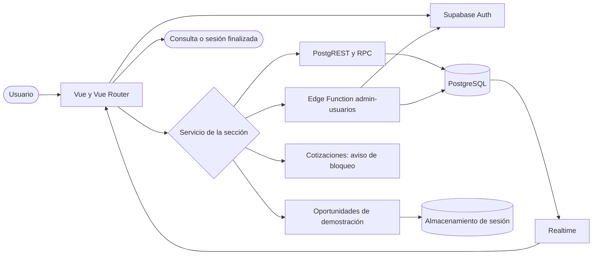

### 10.2 Registro, autenticación y acceso

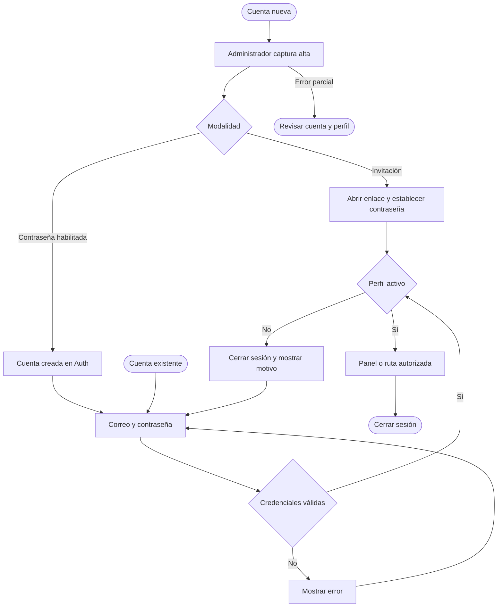

### 10.3 Roles y permisos de ruta

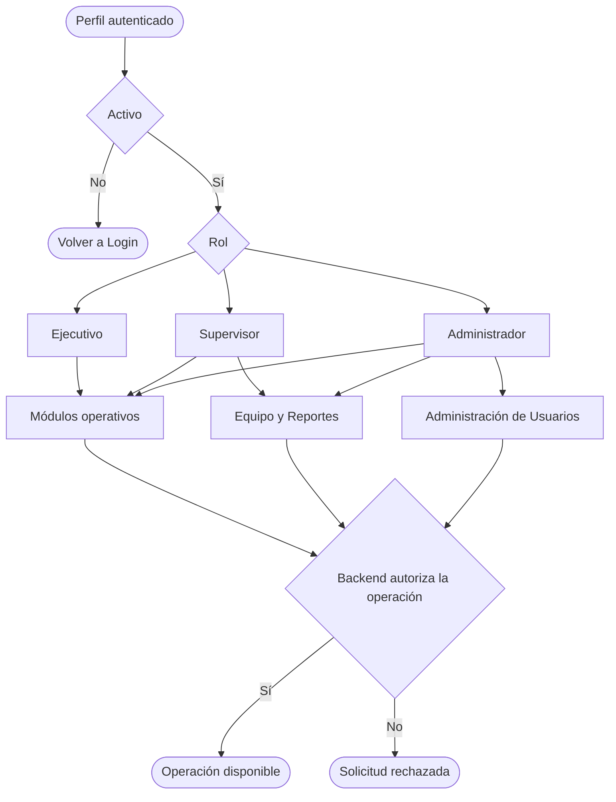

### 10.4 Navegación

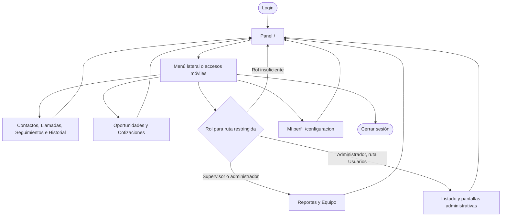

### 10.5 Flujo del ejecutivo

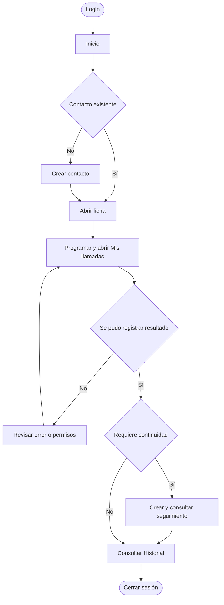

### 10.6 Flujo del supervisor

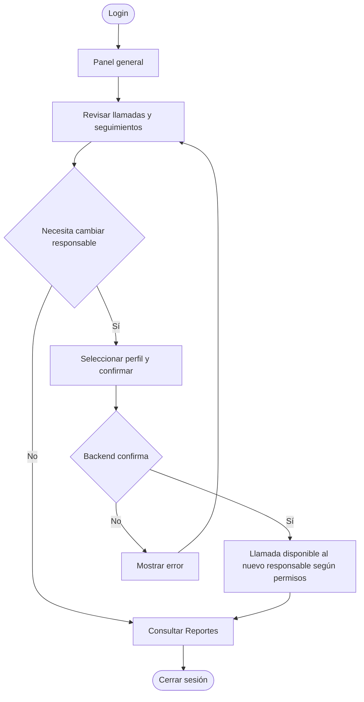

### 10.7 Flujo del administrador

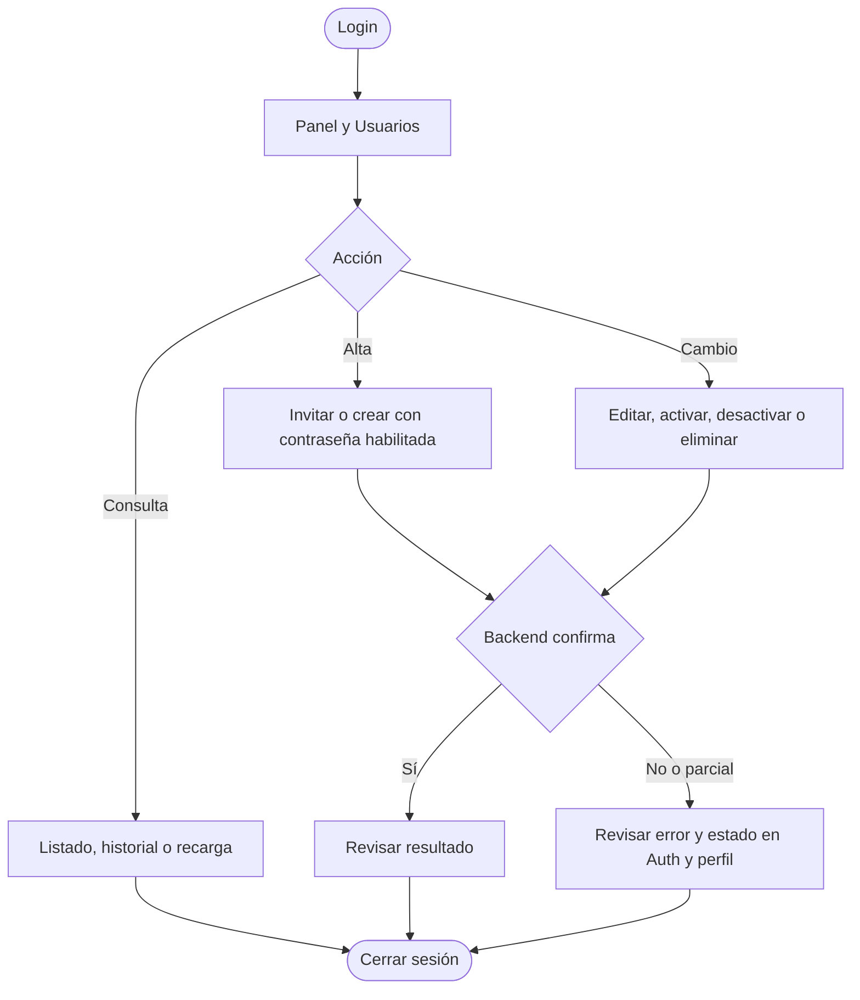

### 10.8 Relaciones entre módulos

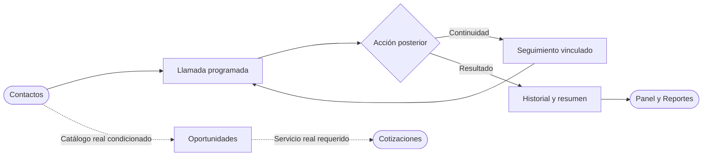

### 10.9 Información y base de datos

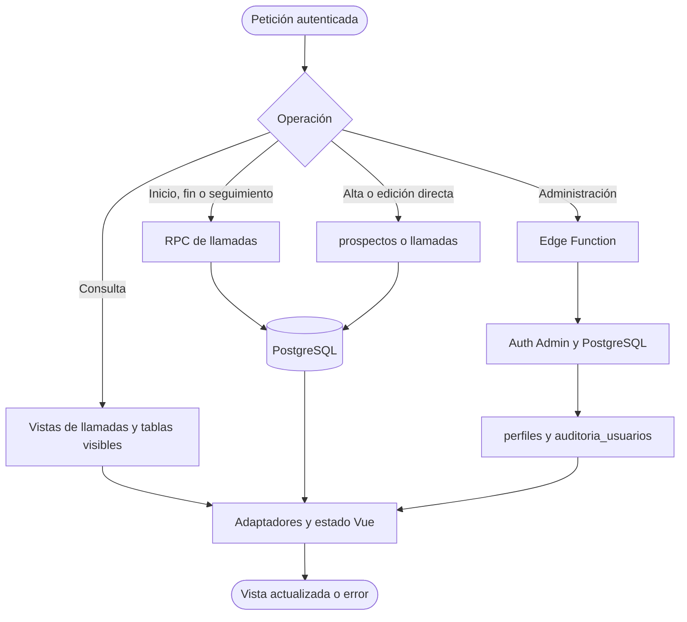

### 10.10 Proceso operativo de principio a fin

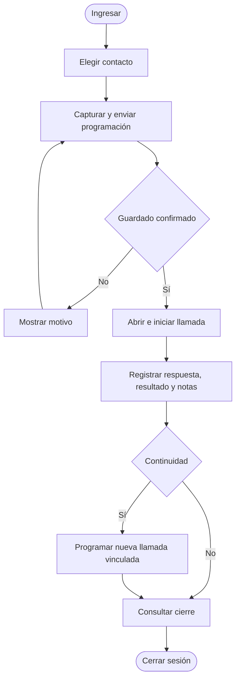

### 10.11 Transferencias de responsabilidad

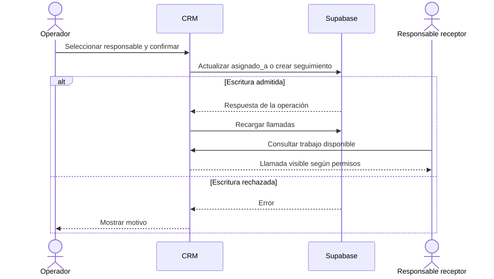

### 10.12 Estados y decisiones

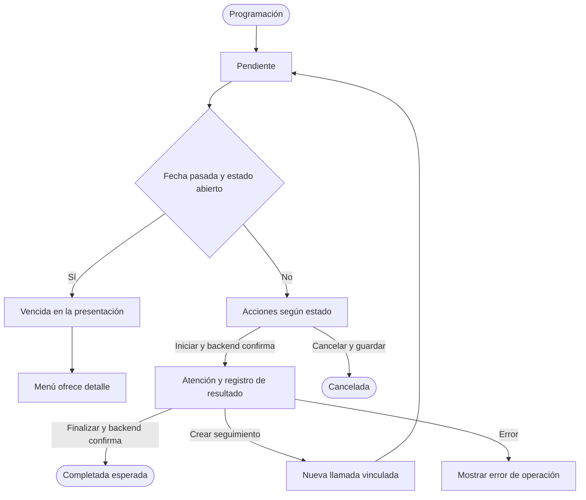

La última figura expresa el recorrido esperado por la interfaz. La fecha puede sobreponer la etiqueta «vencida» a un estado abierto. La definición de las transiciones de las RPC requiere evidencia del servidor. [Estados de llamada](../src/lib/crm.js) · [Acciones](../src/components/AccionesLlamadaMenu.vue)

## 11. Arquitectura técnica

### Frontend

- **Arranque y navegación.** Vue 3 con Vite, Vue Router en modo history y un contenedor común. `App.vue` presenta la comprobación inicial de sesión. El router consulta la sesión antes de resolver la navegación y las pantallas de Usuarios usan metadatos para elegir subvista y parámetros. [Entrada](../src/main.js) · [App](../src/App.vue) · [Router](../src/router/index.js)
- **Estado y componentes.** `useAuthSession` comparte identidad y perfil. `useCrm` reúne selección, carga, filtros, paginación, agregados, errores, formularios y suscripciones. `CrmHeader`, `CrmSidebar`, `TablaLlamadas`, `TarjetaLlamadaMovil` y `DetalleLlamadaDrawer` componen la operación diaria. El contenedor detiene Realtime al desmontarse. [Estado CRM](../src/composables/useCrm.js) · [Componentes](../src/components/)
- **Validación y resultados.** Los formularios validan los datos requeridos. Los servicios y dominios normalizan datos, fechas, teléfonos, correo y valores comerciales. La interfaz muestra carga, vacío, error o resultado y varios guardados protegen frente a envíos repetidos o respuestas inciertas. [Dominio](../src/domain/) · [Adaptadores CRM](../src/adapters/crmAdapters.js)
- **Comercial.** Oportunidades usa servicio de demostración con `sessionStorage` o memoria como alternativa. El adaptador real requiere staging local aprobado. Cotizaciones devuelve un servicio bloqueado con la configuración actual y requiere un catálogo real. El PDF se genera en el navegador con jsPDF y sus recursos locales. [Configuración de oportunidades](../src/modulos/oportunidades/esquemas/contratoOportunidadesSupabase.js) · [Configuración de cotizaciones](../src/modulos/cotizaciones/esquemas/contratoCotizacionesSupabase.js) · [PDF](../src/modulos/cotizaciones/utilidades/cotizacionPdf.js)

### Backend y base de datos

| Entidad o interfaz | Relación y operaciones observadas |
|---|---|
| `auth.users` y `perfiles` | La identidad y el perfil se enlazan por el mismo ID. Se leen rol y estado activo. Administración contempla altas, actualización, activación o bloqueo y baja, y comprueba condiciones de claves foráneas antes de borrar |
| `prospectos` y `llamadas` | La llamada se vincula a un prospecto y usa perfiles como creadores y asignados. El CRM hace lecturas y escrituras directas. En llamadas modifica datos, fecha, responsable o cancelación. Las RPC `iniciar_llamada`, `finalizar_llamada` y `crear_seguimiento_llamada` reciben el ID y argumentos de la acción |
| `vista_llamadas_detalle`, `vista_llamadas_hoy`, `vista_llamadas_vencidas` | Lecturas para listado, detalle e indicadores. La vista detalle admite filtros y paginación en el servicio |
| `catalogo_motivos_llamada`, `catalogo_resultados_llamada`, `historial_llamadas` | Lecturas para selección de motivo y resultado y consulta de eventos por llamada |
| `notificaciones`, `imagenes_llamadas` y bucket `crm-llamadas-imagenes` | Notificaciones por usuario y escritura personal `marcar_notificacion_leida`. Consulta, metadatos, operaciones de objetos y URL firmada para imágenes de una llamada |
| `oportunidades`, `embudos`, `etapas` y `eventos_oportunidad` | El adaptador modela cliente, responsable, embudo, etapa y eventos asociados. Operaciones previstas por `crear_oportunidad` y `actualizar_oportunidad` |
| `cotizaciones` y `cotizacion_conceptos` | Oportunidad → cotización → conceptos. La cabecera y los conceptos se leen por separado. `crear_cotizacion` y `actualizar_cotizacion` reciben los conceptos y el adaptador relee por el UUID devuelto |
| `auditoria_usuarios` y `crm_internal.administrar_perfil` | El backend consulta auditoría con referencias a actor y objetivo. Comprueba el contrato de la función interna para operaciones administrativas. La eliminación segura revisa dependencias y coordina Auth y PostgreSQL |
| RPC `mi_contexto_crm` | Consulta que incorpora el contexto del usuario durante la inicialización |

Evidencia. [Servicio de llamadas](../src/services/crmSupabaseService.js) · [Oportunidades](../src/modulos/oportunidades/adaptadores/adaptadorOportunidadesSupabase.js) · [Cotizaciones](../src/modulos/cotizaciones/adaptadores/adaptadorCotizacionesSupabase.js) · [PostgreSQL administrativo](../supabase/functions/_shared/adminUsuariosPostgres.js)

### Comunicación y controles

El cliente Supabase usa URL y clave pública configuradas y la sesión del usuario. Auth gestiona credenciales y tokens. PostgREST recibe lecturas, escrituras y RPC, y Realtime entrega cambios que el navegador utiliza para volver a consultar. La Edge Function valida el token, el origen y la autorización del actor, y usa sus conexiones administrativas en el servidor. El backend comprueba el perfil activo y contiene protecciones en acciones sensibles, como cambios sobre el propio usuario y eliminación con dependencias. Las operaciones administrativas que afectan dos sistemas pueden quedar en estado parcial.

La protección de staging agrega una comprobación de escritura en servicios y un filtro de peticiones para el proyecto objetivo. En el entorno local de staging inspeccionado está desactivada la habilitación de escrituras. El filtro permite Auth, operaciones de lectura, la firma de URLs y las excepciones de `mi_contexto_crm` y `marcar_notificacion_leida`. Los mecanismos de habilitación de Oportunidades, Cotizaciones y contraseñas administrativas se evalúan adicionalmente.

La carpeta Supabase contiene el código de la función administrativa y sus dependencias compartidas. Los SQL de diagnóstico y las propuestas están en `docs/sql`. La revisión carece de un esquema completo versionado que permita afirmar qué políticas RLS, grants, restricciones, triggers y publicaciones están aplicados en el entorno remoto. Las relaciones de la tabla describen contratos usados por el código. La firma, permisos y comportamiento de las RPC de negocio requieren confirmación en la instancia.

Evidencia. [Cliente](../src/lib/supabase.js) · [Protección staging](../src/lib/stagingWriteProtection.js) · [Habilitación de contraseñas](../src/config/usuariosAdminPasswordWrites.js) · [Edge Function](../supabase/functions/admin-usuarios/index.ts) · [SQL de diagnóstico](sql/)

## 12. Funcionalidades implementadas y pendientes

**Implementada y verificada** indica el alcance local nombrado en la fila. Las tres pruebas omitidas cubren JWT reales por rol, CRUD real de Auth, perfil y auditoría, y alta directa y reemplazo de contraseña en staging.

| Módulo | Función | Estado | Dependencias | Observaciones |
|---|---|---|---|---|
| Acceso | Guardia y rutas | Implementada y verificada | Router y pruebas locales | Cobertura local de rutas y metadatos. [Pruebas](../tests/rutas.test.js) |
| Acceso | Login, identidad, rechazo de inactivos y salida | Implementada sin verificar | Auth, perfil y permisos de lectura | Requiere prueba con usuarios reales por rol. [Sesión](../src/composables/useAuthSession.js) |
| Acceso | Establecer contraseña por invitación | Implementada sin verificar | Entrega de correo, redirects y Auth | Requiere comprobar un enlace real en staging. [Vista](../src/views/EstablecerAccesoView.vue) |
| Acceso | Registro autónomo | Pendiente | Definición de alta pública | El acceso para cuentas nuevas parte de Usuarios. [Rutas](../src/router/index.js) |
| Contactos | Validación, duplicados y manejo de guardado local | Implementada y verificada | Formulario y lógica local | Pruebas de formulario y guardado. [Pruebas](../tests/contactosGuardado.test.js) |
| Contactos | Lectura, alta y edición persistidas | Bloqueada por dependencias | Staging con escritura, permisos y filas de prueba | El servicio usa `prospectos`. La lectura y el alcance remoto quedan por confirmar. [Servicio](../src/services/crmSupabaseService.js) |
| Llamadas | Listado, filtros, detalle y bitácora | Implementada sin verificar | Vistas, catálogos y RLS | La bitácora se consulta por llamada. [Servicio](../src/services/crmSupabaseService.js) |
| Llamadas | Alta, edición, inicio, resultado, reasignación, reprogramación y cancelación | Bloqueada por dependencias | Escrituras de staging, grants y RPC | Código disponible. Transiciones y permisos requieren evidencia remota. [Servicio](../src/services/crmSupabaseService.js) |
| Seguimientos | Grupos por fecha y estado, apertura de detalle | Implementada sin verificar | Resumen de llamadas y vista de vencidas | Hoy y completadas pueden coincidir. [Agrupación](../src/composables/useCrm.js) |
| Seguimientos | Creación desde llamada previa | Bloqueada por dependencias | RPC, permisos y escrituras de staging | La llamada padre y el responsable se envían en la solicitud. [Servicio](../src/services/crmSupabaseService.js) |
| Historial | Tabla de gestiones y detalle separado | Implementada sin verificar | Resumen y bitácora por llamada | Historial tabular usa el resumen, incluso para llamadas abiertas. [Vista](../src/views/HistorialView.vue) |
| Panel y Reportes | Cálculo local de respuestas | Implementada y verificada | Métricas y datos de prueba | Cobertura local del conteo. [Pruebas](../tests/crmMetrics.test.js) |
| Panel y Reportes | Consulta y agregados sobre datos del entorno | Implementada sin verificar | Vistas y datos visibles | El resumen general solicita hasta 200 filas. [Carga](../src/composables/useCrm.js) |
| Notificaciones | Lectura, Realtime y marcado | Parcialmente implementada | Tabla, publicación, RPC e interfaz | Operaciones y estado existentes; bandeja y activación visual pendientes. [Composición](../src/composables/useCrm.js) |
| Adjuntos | Imágenes de una llamada | Parcialmente implementada | Storage, metadatos y controles de interfaz | Servicio disponible, acceso visual pendiente. [Servicio](../src/services/crmSupabaseService.js) |
| Oportunidades | Tablero, filtros, edición y etapas de demostración | Implementada y verificada | Servicio local | Pruebas de servicio y vista. Los datos pertenecen a la sesión. [Pruebas](../tests/oportunidades.test.js) |
| Oportunidades | Operación con datos reales | Bloqueada por dependencias | Proyecto staging, RLS, grants, RPC y JWT | Configuración con verificaciones pendientes. [Configuración](../src/modulos/oportunidades/esquemas/contratoOportunidadesSupabase.js) |
| Cotizaciones | Formulario, conceptos, vista previa y PDF en pruebas | Implementada y verificada | Servicio inyectado y recursos PDF | Alcance local. [Pruebas de vista](../tests/cotizacionesVista.test.js) · [Pruebas de PDF](../tests/cotizacionPdf.test.js) |
| Cotizaciones | Listar, crear, editar y descargar desde la ruta operativa | Bloqueada por dependencias | Oportunidades reales, columnas, contrato RPC y validaciones de staging | En el recorrido habitual se muestra el aviso. [Vista](../src/modulos/cotizaciones/vistas/ListaCotizaciones.vue) |
| Usuarios | Pantallas, controles y contratos administrativos simulados | Implementada y verificada | Pruebas de vista y backend | Verificación local de la navegación y respuestas simuladas. [Pruebas](../tests/) |
| Usuarios | Listado y auditoría remotos | Implementada sin verificar | Edge Function, JWT y PostgreSQL | Requiere comprobar disponibilidad y registros en el entorno. [PostgreSQL](../supabase/functions/_shared/adminUsuariosPostgres.js) |
| Usuarios | Invitación, edición, estado y eliminación | Bloqueada por dependencias | Edge, Auth Admin, función interna y escritura de staging | Confirmar resultado y dependencias antes de repetir una operación parcial. [Ejecutor](../supabase/functions/_shared/adminUsuariosExecutor.js) |
| Usuarios | Alta con contraseña y cambio de contraseña | Bloqueada por dependencias | Habilitación por entorno, administrador activo y backend validado | La prueba con Auth real quedó omitida. [Configuración](../src/config/usuariosAdminPasswordWrites.js) |
| Usuarios | Diagnóstico de conexión en desarrollo local | Implementada sin verificar | Origen local permitido, sesión y backend | La vista limita su disponibilidad. [Diagnóstico](../src/services/usuariosAdminDiagnostico.js) |
| Equipo | Gestión de equipo desde su pantalla | Pendiente | Diseño funcional y datos | Ruta y vista genérica registradas. [Contenedor](../src/views/CrmShellView.vue) |
| Configuración | Ajustes personales y administrativos | Pendiente | Pantalla y operaciones | Existe un destino para Mi perfil. [Contenedor](../src/views/CrmShellView.vue) |
| Comercial | Envío o aprobación de cotizaciones, pago y posventa | Pendiente | Flujos e integraciones específicas | La vista ofrece previsualización y descarga bajo un servicio habilitado. [Vista](../src/modulos/cotizaciones/vistas/ListaCotizaciones.vue) |

## 13. Conclusiones y recomendaciones

1. Validar primero el circuito de Contacto → Llamada → Resultado → Seguimiento con cuentas de prueba en staging y registrar el resultado observado por cada rol, incluida la visibilidad tras una reasignación.
2. Incorporar al expediente técnico una captura autorizada del esquema remoto, las políticas RLS, grants, RPC, triggers y publicaciones. Verificar también las reglas de acceso por propietario, alcance del supervisor y bloqueo de perfiles inactivos.
3. Medir el efecto del límite de 200 registros sobre el panel, el historial y los reportes antes de usar sus cifras como totales de gestión. Revisar también el tratamiento de estados abiertos con fecha vencida y el alcance de las vistas de hoy y vencidas.
4. Validar el alta administrativa desde la invitación hasta el primer Login y documentar cómo reconciliar los casos parciales entre Auth y perfiles. Ejecutar los casos reales omitidos en un entorno aislado cuando estén disponibles las dependencias.
5. Habilitar la operación comercial real según la evidencia del contrato, permisos y persistencia en staging, comenzando por Oportunidades y siguiendo con Cotizaciones. Priorizar después el contenido funcional de Equipo, Configuración, notificaciones y adjuntos según las necesidades operativas.

Referencias de cierre. [Pruebas](../tests/) · [Diagnósticos SQL](sql/) · [Configuración de integraciones](../src/config/) · [Código administrativo](../supabase/functions/)
